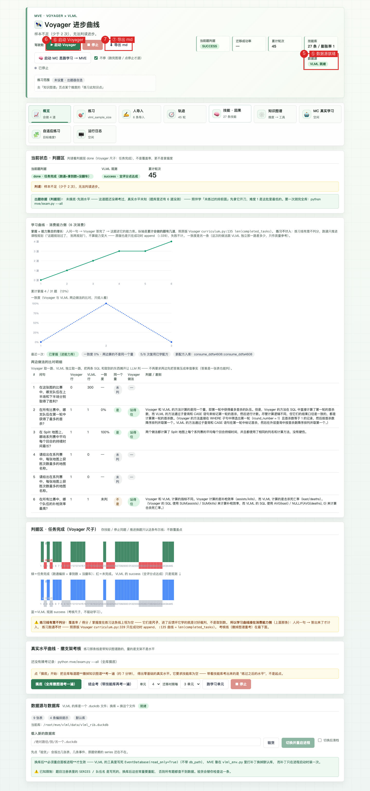
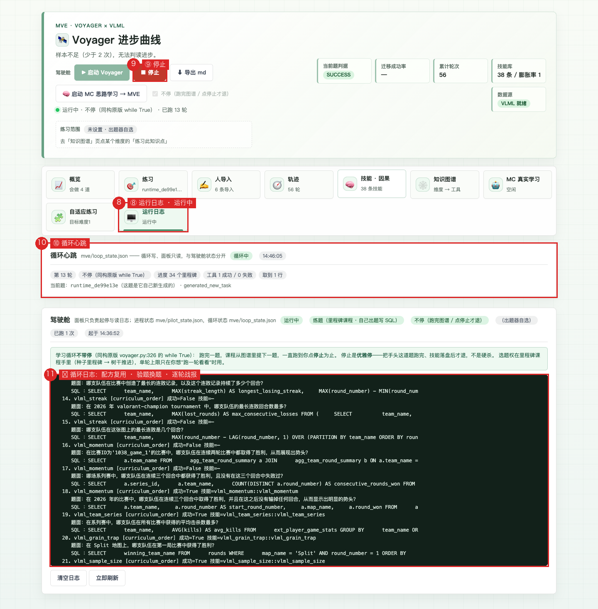
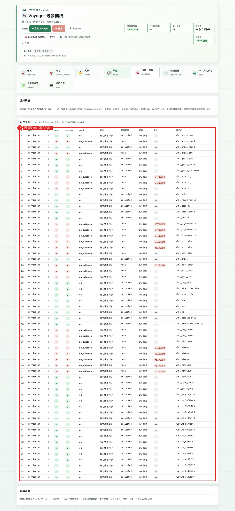
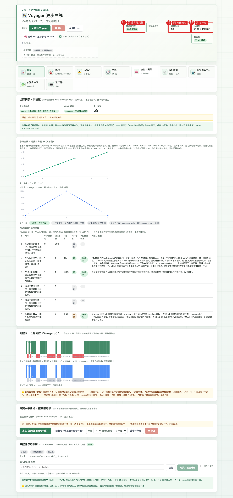

# MVE：让 Voyager 在 VLML 上学会「取数编排」

> **线上面板**：<https://43.161.203.50:8443/mve/>（腾讯云，无鉴权，任何设备直接打开）
> **仓库**：<https://github.com/Zxy876/voyager-vlml-mve>
> **最后更新**：2026-10-13（后端已换成 `voyager_vlml/`，消费线 `consume.py` 通了）

一个跑得起来的原型，回答一个问题：**当"学习者"不是人而是 agent 时，
一套给人用的学习机制还剩下哪些是能直接搬的？**

- 数据层 **VLML**（Valorant 电竞数据，21 张原生表 + 4 张 ext 表 / 46 个洞察 SQL / 10 个 MCP 工具：`query_sql` + `get_database_info` + 8 个报告工具）
- 学习机制取自**猫娘伴学**（N.E.K.O `study_companion`）—— 它有成熟的知识图谱、掌握度与判分契约
- 被考察的学习者是 **Voyager** 式的 agent

一句话：**继承场景，替换链路，新写「agent 当学习者」这一层。**

---

## 0. 三十秒看懂

### 两条线，一套能力，两个判据

| | **练习线**（`voyager_vlml/loop.py`） | **消费线**（`voyager_vlml/consume.py`） |
|---|---|---|
| 谁出题 | 里程碑课程（它自己推进） | **人写一句想问的话** |
| 它做什么 | 自己出题 → 自己写 SQL → 取数 | **用已积累的能力回答**（复用配方 → 回填实体值） |
| 成败判据 | `success` = **有没有真的从 DB 取到数**（且不是真空值，见第 21 章） | 答没答出来（取到真数 + 给出回答） |
| 算不算分 | **不算覆盖率、不算掌握度** | **从这里开始算**覆盖率与掌握度 |
| 判分给谁看 | 不给任何人（它自己看 DB） | **只给人看**，绝不回灌 Voyager |

两条线共用同一套能力（技能库里的 SQL 配方 + 图谱节点），但**账本分开**：
练习不判分，消费才判分。这是有意的——VLML 的尺子不能进 Voyager 的反馈环，
否则它学的就是"讨好裁判"，不是"取到数"。

### 掌握 = 能力集合的增长，不是分数

> 用户定义（2026-10-13）：**「我问你一句，Voyager 答完了，之后这题就到他的
> 能力里了；这就是掌握！」**

所以掌握度 = `已掌握的能力项 / 该掌握的总量`（图谱节点 + 消费期新增项），
**与覆盖率彻底拆开**：覆盖率只是"这次答得全不全"的质量分，
不参与"这题算不算学会"。

### 当前快照（2026-10-14 01:57 复测；10-13 19:24 起服务器侧重新计数）

| 项 | 值 |
|---|---|
| 练习 `run_log.jsonl` | 45 条，其中成功 17（新后端里程碑课程） |
| 技能库 | 19 条，**全部是 SQL 配方**；其中 6 条 10-14 真空审计后修复（见第 21 章） |
| 图谱进度 | 17 个里程碑已解锁 |
| 能力项总量 | 31（面板掌握度的分母，含种子题与运行期/消费期新增） |
| 撤支架考核 / 消费日志 | 服务器侧 0 / 10 条（考核线还没在服务器上跑过） |
| 数据源 | `vlml_rib.duckdb`（rib.gg；面板自检 9 张表 / 4 条编排提示，默认库） |
| 面板 | <https://43.161.203.50:8443/mve/> · 9 个分区 |

⚠️ **练习线的 `success` 不等于"学会了"**：它只表示"这一轮真的从库里取到数了"。
真实水平要看撤支架考核（`exam_log`）与消费线（`coach_log`）—— 那两条线在服务器
上还没跑过（考核 0 条；消费日志 10 条含两次同题复测）。

---

## 1. 这一版相对旧原型：哪层继承、哪层替换、哪层新写

| 层 | 判定 | 内容 |
|---|---|---|
| 数据源 / 使用场景 / 问题背景 | **原样继承** | Valorant 赛事数据、教练视角的洞察需求 |
| 解决问题的方式 | **替换件** | 整条链路换成 VLML：MCP 把模型直接连到数据库，要数字就查、不许猜 |
| Voyager 亲历学习、积累技能 | **新写（已重写一遍）** | 见第 3 章：旧后端违反设计，2026-10-12 从原版 Voyager 重建 |
| 人问一句 → 用它积累的能力回答 | **新写** | 见第 4 章：消费线 |
| 学习面板（衡量 Voyager 的进步） | **新写** | 学习插件面板本来给人用；这里的学习者是 Voyager |

---

## 2. 系统全貌

```
                    ┌──────────── 人（面板 /mve/）────────────┐
                    │  概览 · 练习 · 人导入 · 轨迹 · 技能·因果 │
                    │  知识图谱 · MC 真实学习 · 自适应 · 日志  │
                    └───────────────┬───────────────────────┘
                                    │ /api/state（4 秒轮询）
              ┌─────────────────────┴─────────────────────┐
              │                                           │
    ┌─────────▼──────────┐                    ┌───────────▼───────────┐
    │  练习线 loop.py     │                    │  消费线 consume.py     │
    │  curriculum 选题    │                    │  人问一句 → 找配方     │
    │  question  出题     │                    │  回填实体值 → 取数     │
    │  action    写 SQL   │                    │  VLML 独立取一遍       │
    │  critic    DB 取证  │                    │  比对做法 → 叙事洞察   │
    └─────────┬──────────┘                    └───────────┬───────────┘
              │                                           │
              └──────────────┬────────────────────────────┘
                             │
              ┌──────────────▼───────────────┐
              │  env/vlml_mcp.py（VLML MCP） │  ← 10 个工具，只回指标不回叙事
              │  DuckDB（vlml_vlr / vlml_rib）│
              └──────────────────────────────┘
```

### 目录地图

| 路径 | 是什么 |
|---|---|
| `voyager_vlml/` | **当前后端**。原版 Voyager 五步的 VLML 同构版（练习 + 消费） |
| `voyager_vlml/agents/` | `curriculum`（选题）/ `question`（出题）/ `action`（写 SQL）/ `critic`（判成败） |
| `voyager_vlml/env/vlml_mcp.py` | 环境层：把 VLML 的 10 个 MCP 工具包成 `{ok, tool, rows, error, data}` |
| `voyager_vlml/control_primitives/` | SQL 原语（原版 control_primitives/*.js 的同构替换） |
| `voyager_vlml/consume.py` | **消费线**：人问一句 → 用已积累能力回答 → 判分 → 进能力库 |
| `mve/` | 面板与数据层：`dashboard.py`（前端+API）/ `panel_data.py`（聚合）/ `coach.py`（旧 VLML 解释通路） |
| `mve/topic_graph.py` | 图谱节点 + 掌握度账本（伴学同构） |
| `mve/knowledge_graph.py` | VLML 侧的 21 张表 / 46 洞察 / 实体可填值图谱 |
| `mve/tasks.py` `planner.py` `exam.py` `learn.py` | 旧题库、出题器、撤支架考核、学习进程调度（考核线仍在这套上） |
| `mve/vlml_source/` | 数据抓取：`vlr_client` / `rib_client` / `ingest` |
| `voyager_original/` `study_companion/` | **只读参照**（原版取证用，不分发、不改） |

---

## 3. 练习线：在原版 Voyager 上重建的五步

### 为什么要重建（旧后端违反了一条设计硬约束）

旧后端（冻结在 `mve/voyager.py` + `mve/run_mve.py --llm`）的反馈骨架是：

```
Voyager 的事实集 → evaluate_vs_referee() 比对 VLML0 裁判算出的标准答案
                 → verdict / covered / missing / coverage / score 全部回流进 Voyager 上下文
```

那等于**拿 VLML 跑通的答案标准给 Voyager 当反馈**。设计上 VLML 的判分
只给人看（判分权不能进学习环，否则它学的是"讨好裁判"）。2026-10-12 按用户指令
从原版 Voyager 重建，后端整体换成 `voyager_vlml/`。

### 五步同构（用户指令原文 → 落地）

| # | 用户指令 | 落地 |
|---|---|---|
| ① | MC 初始化携带的信息 → VLML 同构版里程碑 | `agents/curriculum.py` |
| ② | control_primitives 的 JS 代码 → SQL 原语 | `control_primitives/sql_primitives.py` |
| ③ | 在 voyager 环境里安装 VLML MCP 依赖（DB/RIB/VLGG） | `env/vlml_mcp.py` |
| ④ | 迭代修正机制 prompt 里的语言 → SQL | `agents/action.py` + `agents/critic.py` |
| ⑤ | 面板后置（先验证后端闭环） | `loop.py` 冒烟 |

### MC 字段 → VLML 同构对照（这是"同构"的骨架）

| 原版 Minecraft | VLML | 说明 |
|---|---|---|
| `biome` | 数据源（rib / vlgg / DB） | 世界是什么 |
| `nearby_blocks` | **可见表**（按进度档解锁） | 现在能摸到什么 |
| `other_blocks` | 其它见过的表 | — |
| `nearby_entities` | 实体可填值（库里真实取值范围） | 实查，不手写；**⚠️ 只进面板，不进上下文**（见下） |
| `inventory` | 当前实体锚点（series / team / map） | — |
| `chests` | **已学会技能**（可复用 SQL 配方） | 技能库 |
| `completed_tasks` | 已解锁里程碑（图谱节点已完成） | — |
| `failed_tasks` | 失败 / 跳过（**带原因**） | — |
| `"Mine 1 wood log"` | **VLML 种子里程碑**（树干起点、无前置） | 硬编码的第一题 |
| —（新增） | 里程碑树 `seed / trunk / keystone` + 随机 (表,列) 最小单位 | MVE 自创 |

### 闭环

```
curriculum.propose_next_task()     ← 里程碑树选题（种子 → 树干，已完成排除）
        ↓
question.generate(topic)           ← LLM 按里程碑节点出题（只出题面，不给答案）
        ↓
skill_store.retrieve(tid, q)       ← **检索已学会的 SQL 配方**（同题优先 + 跨题门槛）
        ↓                            → 拼进 system prompt（照原版 voyager.py:195/199）
action.solve(question, skills=...) ← LLM 写 SQL → VLML MCP 执行
                                      失败带 critique 迭代重写（最多 3 轮）
        ↓
critic.check_task_success()        ← 成败 = 有没有真的从 DB 取到数（不比标准答案）
        ↓
skill_store.add(...) + mark_result ← 跑通才存新配方；注入过的配方记一次成败
        ↓
curriculum.update_exploration_progress()  ← 跑通 → 解锁里程碑 + 挂 SQL 技能指针
                                             否则记失败/跳过（带原因）
```

**整条链里没有 VLML 判决、没有覆盖率、没有参考答案。** 那些只在面板上。

### 技能复用链：retrieve → 注入 → 跑 → 存 + 计数（照原版四步）

原版的顺序（`voyager_original/voyager/voyager.py`）：

| 步 | 原版 | 行号 |
|---|---|---|
| ① 检索 | `skills = self.skill_manager.retrieve_skills(query=self.context)` | `:195` |
| ② 注入 | `system_message = action_agent.render_system_message(skills=skills)` | `:199` |
| ③ 跑 | rollout（写码 → 执行 → 观察） | `:214+` |
| ④ 存 | `self.skill_manager.add_new_skill(info)`（**成功才存**） | `:370` |

**此前练习线只做了 ④**：`loop.py` 里只有 `skill_store.add()`，①②③ 一次都没做。
后果不是"数字不好看"，是**技能库成了单向仓库** —— 服务器上一度 25 条真 SQL
写进去，一条都没被用过；`hits` / `ok` 恒为 0，因为 `mark_used()`（`skill_store.py:313`）
**只在 retrieve 之后被调用**。

2026-10-13 按原版补齐：

- `_retrieve_skills(tid, question)`：每趟**要写 SQL 之前**检索（同题优先 + 跨题
  相似度门槛 + 有效性加权），检索到就 `mark_used`（注入了才算一次命中）。
- `render_system_message(skills=[...])`：照原版 `action.py:94` 的 `+ skills`，
  配方拼在取数原语后面，**进 system 区块**所以迭代修正的每一轮都带着。
- 判成败后 `mark_result(keys, success)`；`mark_result` 只记成功，所以
  「hits 涨、ok 不涨」= 注入了没帮上 —— 它会在 `retrieve()` 的
  `0.6*(ok/hits)` 项里自然沉底。
- ⚠️ **两条写 SQL 的路都要检索**：`_generate_new_task` 的验题那一趟（种子课程
  跑完之后走的**全是**这条生成路径）和现场写那一趟。返回值多带一个 `gen_keys`，
  保证同一题同一次注入**只记一次 hit**。

**一处必要偏差**（两边技能形态不同，必须说清）：

> 原版技能是**带参数的函数**（`async function mineBlock(bot, name, count)`），
> 复用天然就是"换参数调用"，所以原版注入时一句解释都不写。
> 我们的技能是一整条**写死了字面量的 SQL**（`WHERE team_name = 'NRG'`）——
> 它是实例，不是函数。不写使用规则，模型会把上次的值原样抄过来，
> 取到的就是上一题那一队的数：看着像复用，其实是记答案。

所以注入块带了五条规则，核心两条：**配方里的实体字面量是上一次的值，必须换成
当前这道题指的那个值**（用户原话：复用时当前这道题的实体值回填进配方）；
**配方算的量与当前问的不是同一个量 → 不要用**（换队伍名算复用，换量算张冠李戴）。

**实测（服务器，2026-10-13 06:1x）**：

| | 接上之前 | 接上之后 |
|---|---|---|
| 技能条数 | 25 | 31 |
| `hits` 总和 | **0** | **9** |
| `ok` 总和 | **0** | **5** |
| 轮次日志 | 无复用信息 | 每行带 `reused_skills`；控制台 `复用=N 条已学配方` |

被复用过的技能：`runtime_b4b2bb78` 命中 4 / 有效 3（75%）、
`runtime_d049337b` 命中 3 / 有效 2（67%）；`vlml_side_conversion`
命中 1 / 有效 0（那轮 0 行失败）——**有效率这个数开始有区分度了**，
`retrieve()` 的排序也就真的在读它。

### 循环节奏：不带停（同构原版 `while True`）

取证：`voyager_original/voyager/voyager.py:326` 主循环是 `while True`，
`run_voyager_learn.py:55` 的 `--max-iterations` 默认 160。原版里**没有
"跑 N 轮就结束"这一说**。

之前这里把 `rounds` 当硬上限、面板还写死 `rounds:3` → 一次启动只跑 3 道题就
退出，29 个节点的图谱根本跑不完。人看到的就是「三轮就结束了，图谱都没跑完」。

| 节拍 | 现在的行为 | 落地 |
|---|---|---|
| 进入下一题 | 自动课程从**图谱节点**提（种子 → 树干 → keystone） | `topic_graph.select_next` |
| 跳过当前题 | 初试 + 重试 ≥3 次仍跑不通 → stale 换题（**带原因**） | `MasteryStore.add_failure/add_skip` |
| 整轮结束 | **不结束**。一直跳过、进度不涨也不结束 | `run_rounds` 的 `while True` |
| 范围内没可拿下的题 | **不断生成新任务**，且**先验题**（验不过就换，不记失败） | `_generate_new_task` |
| 谁能改变节奏 | 只有「停止」（SIGTERM） | `_install_stop_handler` |

运行期生成的节点会**落盘**到 `mve/runtime_topics.json`（与消费侧的 `consume_<hash8>`
同一份文件，这里登记 `runtime_<hash8>`），启动时装回内存图谱。不落盘的后果
（2026-10-13 实测）：跑 12 轮拿到 14 条新配方、记了 34 个 completed，但图谱节点
一个都没留下 —— 重开又 exhausted、又把同一批题重新验一遍，「不重复规划」直接落空。

停止是**优雅停**：收到信号后把手头这道题跑完、技能落盘再退（原版
"exiting learn loop after current task"），不硬杀。

```bash
python -m voyager_vlml.loop --rounds 0                      # 不停（默认）
python -m voyager_vlml.loop --rounds 0 --max-iterations 60   # 跑满 60 题退
python -m voyager_vlml.loop --rounds 1                       # 只跑一轮看看
python mve/pilot.py                                          # 或面板驾驶舱「练题」
```

⚠️ 钉了具体知识点（`--topic`）时自动降级成 1 轮：不停只会把**同一道题**
反复跑，进度永远停在 0/1。面板上「练习此知识点」就是这条路径，开关会自动锁掉。

### 两个状态文件：循环写自己的，面板只写自己的

| 文件 | 谁写 | 内容 |
|---|---|---|
| `mve/loop_state.json` | **只有** `voyager_vlml/loop.py`（每轮一次） | 第几轮、工具成功/失败几次、取到几行、连续几轮没证据、离上次解锁里程碑几轮 |
| `mve/pilot_state.json` | **只有** `mve/pilot.py` | pid、谁点了停止、起停时刻、退出码 |

面板**只读** `loop_state.json`。必须分家的原因：写在一起会互相覆盖 ——
循环每轮重写会把人刚点的 `stop_requested` 抹掉；面板为显示 pid 重写会把循环
刚落的"这轮没取到数"抹掉。

### 环境反馈清单：什么进上下文、什么只进面板

进**运行时上下文**（Voyager 靠这些决定下一步）：

- 解锁里程碑（图谱节点已完成 —— 布尔，**不含评分**）
- 已学会技能（可复用 SQL 配方）
- 任务失败（带原因）、任务跳过（带原因）
- 环境反馈本身：工具调用成功还是失败、这次取到几行、图谱因为这轮变了什么

**只进面板**（绝不进上下文，走 `scene_context.panel_only()`）：

- 当前实体在库里实际存在哪些取值（`series / team / map ∈ {…}`）
- VLML 跑一遍得到的判定结果：得分 / 覆盖率 / verdict

两条是同一个理由：那不是反馈，是**尺子**（后者）或**答案候选清单**（前者）。
进上下文会把它的重心从"把这一题的取数做通"拉到"讨好尺子 / 枚举取值凑答案"。

同理，场景档位（base 层 → ext 层）的门槛也是**已解锁里程碑数 ≥3**
（`TIER_EXT_UNLOCKS`），不是掌握度 ≥0.8 —— 掌握度是评分结果，不能当披露条件。

### 连续拿不到证据：不停，但要能分辨「没学会」和「链路没跑通」

不带停的循环不能靠"失败就停"兜底，所以循环把每一轮的理由写进心跳，面板按
`no_evidence_kind` 分成三种可见的诊断：

| kind | 含义 | 该去改什么 |
|---|---|---|
| `linkage` | 一次工具都没调成功，且错误是**基础设施类**（打不开库 / 工具没装载 / 模块缺失） | **链路没跑通**：库在不在、VLML 工具装没装、`db_config.json` 指的哪个库。改配置/依赖，跟"它没学会"无关 |
| `sql_error` | 工具**跑起来了**，报的是 Parser / Binder 错误 | **它**的问题：SQL 写错、列名写错、值类型猜错。看日志里具体哪条 SQL 报错 |
| `empty` | SQL 跑通了但取到 0 行 | **它**的问题：过滤条件过严、题面在库里没这个数据。看它写的 WHERE |
| `unproven` | 取到数但 critic 判定不构成有效证据 | 多半取到了错误对象或空壳表 |

⚠️ `sql_error` 这一档是后补的：最初把「SQL 写错」一律归到 `linkage`，于是面板
让人去查"库在不在、工具装没装"—— 查的是根本没错的地方。分诊错的代价跟不分诊一样大。

连续 ≥3 轮时面板出告警条；**循环不因此停下**（设计：只有停止能改变节奏）。

---

## 4. 消费线：人问一句，Voyager 用已积累的能力回答

> 用户指令（2026-10-13）：「现在学习这块已经做好了，消费能力这块咱也得做，
> 就是人导入；写一句你想问的话。Voyager 会用它已积累的能力回答；
> 然后底下 VLML 的解析（调了哪些工具、取到哪些事实）照旧披露。
> **从这块开始来计算覆盖率和掌握度最好了**」

### 六步流水线

```
① 归题（找评分点）→ 同题校验      归不上就派生 / 生成新题，尺子拿错要挡掉
② 定评分点（dimension 名）        取数之前定好，**两边共用同一份**
③ 找已学配方                      技能库里检索（两套 ID 不通，走词面匹配）
④ 取数：复用配方 → 回填实体值      复用不成 → 现场写，如实标 reused=False
⑤ VLML 独立取一遍（只取数不整理）   与 Voyager 那一路并列
⑥ 比对两边的方法与做法 → 判分       一致度即覆盖率
⑦ 叙事洞察 → 进能力库 → 掌握
```

### 4.1 复用的是**计算**，不是数值

配方是以前学会的 SQL。**复用 = 把当前这句话里的实体值回填进配方的计算**
（换队伍 / 换地图 / 换赛事），数值必须重新算。

> 用户原话：「不把『记住数值』当作成功，而是从用方法取出数值的过程开始存技能。
> **回填不存在的，只有更快的计算**」

库里没有可用配方时降级到现场写 SQL，并**如实标注 `reused=False`**
（"这题还没学会，是现做的"——不能假装用了能力）。

⚠️ 回填前先判一件事：**配方算的量与这句话问的量是不是同一个量**。
不是就不执行它、直接现场写。实测踩过：问"崩盘"（要连败），库里只有 K/D 配方，
模型照样把 Cloud9 填进去产出一条 K/D 查询还自称"复用了配方"
—— 数字错还能看出来，**量错了是方向错，比报错危险得多**。

### 4.2 掌握 = 能力集合的增长（判据是"答没答出来"）

```
答完了（调通工具 + 取到数 + 给出回答）
    → mark_completed（这题标记为已掌握）
    → 这次的取数 SQL 存成可复用配方进技能库
```

**判据与覆盖率无关**：覆盖率算不算、算出来多少，都不影响"这题进不进能力库"。
否则就是把 VLML 的判分塞回学习判定。

⚠️ 归不上已有题时**照样进能力库**：按问句 md5 登记稳定能力项 `consume_<hash8>`
（落 `mve/runtime_topics.json`）。**归不上题 ≠ 没答出来** —— 实测：取到 1334 行、
回答完整，却因为归不上旧题库被判"没答出来，未进能力库"。
分母同步 +1（图谱节点 + 消费期能力项），否则掌握度会灌过 100%。

### 4.2.1 学习曲线接**消费能力侧**：练习不计入（2026-10-14）

> 用户（2026-10-14）：「学习曲线那条线接消费能力侧，原来 voyager 学习时不计入。」

**原版取证**（`voyager_original/voyager/agents/curriculum.py`）：

| 行号 | 原版 | 含义 |
|---|---|---|
| `:135` | `return len(self.completed_tasks)` | 学习曲线 = **能力集合的大小**，不是分数 |
| `:339` | `self.completed_tasks.append(task)`（在成功分支里） | **只在成功时** append，失败不计 |
| — | 全文没有"考试" | 原版没有考核线，学习曲线就是能力集合 |

**踩到的坑（服务器实跑打出了 129%）**：

```
已掌握 · 累计 58 / 45 题（掌握度 129%）   ← 分子比分母大
```

根因不是算错，是**语义挤位**：`MasteryStore` 上的 `completed` 位原本只有一个
意思 —— 「这个节点规划过了，`select_next` 别再规划它」，是个**去重位**。
但消费线后来把它**借**来当"掌握"，于是同一个布尔上挤了两种语义，写方三个：

| 写方 | 位置 | 它标这个位的意思 |
|---|---|---|
| 练习循环 | `voyager_vlml/agents/curriculum.py:296` | 跑通了 → 别再规划这道题 |
| 旧后端（已冻结） | `mve/run_mve.py:463` | `ev.success` → 别再规划这道题 |
| **消费线** | `voyager_vlml/consume.py` | 人问一句、答出来了 → **这题我会了** |

分子数 `MasteryStore` 里**全部** completed（58，含练习线那 29 条 `runtime_*`），
分母数「图谱 29 + `runtime_topics.json` 16」—— 而那个文件是练习线与消费线
**共用**的，16 项里 12 项是 `source="practice"`。两套集合口径根本不是一回事。

**修法（三处）**：

1. `mark_completed(tid, *, source=...)` 落 `completed_source`，三个写方分别传
   `practice` / `practice` / `consume`（practice→consume 单向升级，掌握的事实
   不会被练习覆盖掉）。去重位还是去重位，但从此**可审计**。
2. 消费线自己守一本账 `_consume_book()`：读 `coach_log.jsonl` 里
   `mode=voyager_consume` 且 `mastered` 的去重 `topic_id` —— 这正是原版
   `completed_tasks` 的同构物（**学习循环自己那本账，不是全局共享的 mastery 文件**）。
   分母 `_ability_universe()` = 图谱节点 ∪ **消费侧**登记项，把练习线那 12 项排掉。
3. `_consume_curve()` 在**后端重算** `mastered_total`，不信记录里写死的旧口径数
   —— 口径一改，历史记录里那个数不会自己更新（老记录是 58/45，直接画会贴顶
   且越过 100%）。

**实测对照（服务器 43.161.203.50）**：

| | 旧口径 | 新口径 |
|---|---|---|
| 分子 | 58（全部 completed，含练习线 29 条） | **2**（消费侧答出来的去重题） |
| 分母 | 45（图谱 29 + runtime_topics 16，含练习线 12 条） | **34**（图谱 29 + 消费侧登记 5） |
| 掌握度 | **129%** ❌ | **6%** ✅ |

**曲线行为（4 次消费实跑）** —— 纵轴是**累计会做的题有几道**（照原版 `:135`
画绝对数，不画百分比；一画百分比读数就取决于"分母算哪几道题"这种口径争议）：

| # | 问句 | 答出来 | 累计掌握 | 复用配方 |
|---|---|---|---|---|
| 1 | 在 Split 地图上，哪支队伍的胜率最高？ | ✓ | 1 / 34 | ✓ |
| 2 | 在 Ascent 地图上，哪支队伍的胜率最高？ | ✓ | 2 / 34 | ✓ |
| 3 | LOUD 在这批比赛里一共打了多少个回合？ | ✗ | **2** / 34 | ✗ |
| 4 | 哪支队伍的手枪局胜率最高？ | ✗ | **2** / 34 | ✓ |

第 3、4 次失败，累计**停在 2 不动** —— 这就是 `:339` 那条「只在成功时 append」
跑出来的形状：**失败不计入，曲线单调不降**。

⚠️ **诚实的限制**：分母里躺着 29 道课程题（图谱节点），只有人真的通过消费线
问过、并且答出来了才会涨。所以 6% 不是"它只会 6%"，是"人只问过 2 道"。
照用户判据这正是对的 —— 练习线不判分，能力只从消费那侧长；但这意味着
**掌握度要靠人问才会动**，想看满盘得把课程题一道道问过去。

### 4.3 判分 = **直接比对两边的方法与做法**

> 用户（2026-10-13）：「整理事实这个事情本来就是交给 LLM 的，如果在消费侧，
> 直接比对 voyager 和 VLML 的方法和做法，算掌握度和曲线，进能力库，
> 然后让 LLM 产出叙事洞察就好啦」

**旧判法**（已废）：两边各自整理成 `{subject, dimension, value}` → 按
`(subject, dimension)` 键比对 → 覆盖率。
脆在"整理"这步：答案是一张表时压不进单值事实 → 两边都交白卷 →
覆盖率落空 + 回答为空（**实测取到 85 行却显示"Voyager 回答不出来"**）。

**新判法**：把两边的 SQL 与取到的结果摊开，让 LLM 判——
是不是同一口径？Voyager 那一路有没有硬伤（除零 / 列名错 / 粒度错 / 方向反）？
**一致度即覆盖率**。LLM 天生擅长这种语义比对，不需要先把结果压成键值。

裁判侧因此**只取数、不整理**（`_referee_observations`），省掉两次最容易交白卷的调用。

### 4.4 实测踩过的坑（每条都有证据，不是推断）

| 坑 | 实测证据 | 修法 |
|---|---|---|
| **schema 里有空表** | rib 库 `agg_*` 全 0 行，数据在 `ext_player_round_stats`(2850 行)。模型看着 agg 表名更"正规"就去查 → 0 行 → 报"没取到数" | `schema_block` 带**每张表行数**，空表明写"查它只会得 0 行"；有数据的表排前面防截断 |
| **答出来了却进不了能力库** | 1334 行 + 完整回答，面板显示"没答出来，未进能力库" | 按问句哈希登记能力项，归不上题照样进 |
| **两边都 0 行判了 100%** ⚠️最危险 | Cloud9/Corrode 在当前库无数据，两边各 0 行、SQL 长得一样 → 判"口径一致 100%" | **任一 0 行不判分**。等于给"都没取到数"发满分，比报错危险 |
| **voyager_sound 被冤枉** | 裁判自己多算 deaths 算成 K/D，Voyager 明明正确却判"有硬伤"（reason 里还写着"无硬伤"） | 强制判定顺序（先看 Voyager 自己那条 SQL）+ 一致性兜底 |
| **叙事被 token 截断** | 1334 行让它讲，逐地图铺开，输出卡在半句上 | 限制 250 字 + 不许逐行罗列 |
| **口径不同显示红色 0%** | 误导成"它能力不行"，实际是裁判跑偏 | 新增 `judged` 字段：口径不同 = "没真正判到"，显示灰标 |

### 4.5 面板上怎么看

- **人导入**分区：写一句话 → 交给 Voyager 回答（后台跑 1～3 分钟，有进度条）
- 结果**落进导入历史**（不是只弹一次回执——后台执行后刷新就没了）
- **学习曲线 · 消费能力侧**（放在**概览页首位**，不只是人导入页才有）：
  主曲线 = 累计会做的题**有几道**（纵轴是绝对数，照原版 `curriculum.py:135`
  `len(completed_tasks)`），副线 = 一致度（虚线）。
  **练习不计入**：失败那几次曲线是**走平**，不是掉头往下 —— 这就是"学习时
  不计入"在图上长什么样。考核线（撤支架重考）在更下面（见 4.2.1）
- **两边做法的比对明细**表：每次消费的 Voyager 行数 / VLML 行数 / 一致度 /
  是不是同一个量 / 判据原文

```bash
python -m voyager_vlml.consume "每个回合中各个角色的平均击杀数是多少？"
```

---

## 5. 数据契约：Voyager 的产出是**事实集**，不是一段话

```jsonc
{ "subject":   {"series": "2843069", "map": "Corrode", "team": "Cloud9"},  // 交叉键字典
  "dimension": "key_metrics.team.consistency.kast.num",                    // 指标名，可点号嵌套
  "value": 109, "unit": "count",
  "base":  109,                                                            // 分母，百分比类必须有
  "scope":  {"rounds": 59, "confidence": "Strong"},
  "source": {"tool": "match_analysis_report", "section": "key_metrics"} }
```

| 设计点 | 为什么 | 实现 |
|---|---|---|
| `subject` 是**交叉键字典**不是字符串路径 | `mitch on Skye`、`Corrode R4` 这种多维交叉，字符串拼不出 | `loop_core.norm_subject()` 会把字符串也归一成字典 |
| 必须有 `base`，且**参与评分** | 67% (16/24) 与 67% (2/3) 数值相同但不是同一个事实 | `base < min_base` 直接判缺失，**数值对也不算数** |
| 吃得起两个极端 | `query_sql` 任意 SQL → 一行一列一个事实；报告工具聚合 → 每个 key 一个 dimension | JOIN / CASE / 窗口派生列都不影响 |
| diff 单元 = `(subject, dimension)` 对 | 与 rubric 做**覆盖率**比对，不是路径一致性——不惩罚殊途同归 | `loop_core.fact_key()` |

**判定次序（确定性层先跑，不调 LLM）**：

```
0. 工具调用闸 —— 一次工具都没调成功 → 整轮判「无证据」   ← 防编造
1. base 过闸   —— 分母不够，数值对也不算数
2. (subject, dimension) 命中
3. 值容差比对 —— 容差只从服务端 answer_spec 读
判不了的点 → unjudgeable，不静默算对也不静默算错
```

`confidence` 四档（`n≥100 Strong / 50-99 Moderate / 20-49 Weak / <20 Insufficient`）
**由 `base` 直接算出**，落进确定性层，不用问模型。

### 叙事在哪、怎么声明不参与比对

| 位置 | 标记 |
|---|---|
| 解释输出区（VLML + 其 LLM 产出） | `comparable: false` |
| Voyager 答卷末尾的 narrative 段 | `comparable: false` |
| 出题器生成的题干 | 参与比对的是 key_points，不是题干文本 |

双重标记：机器可读 `{"narrative": {"text": "...", "comparable": false}}`
＋ 面板上人可读的「不参与比对」标签。这条边界 VLML 自己就画好了
（`README.md:97`：All reports return metrics and evidence only. LLMs should generate insights.）

---

## 6. 意图是对象，不是自由文本

出题器产出的是**对象**：`question + answer + key_points[] + rubric{评分点: 权重}
+ solution_steps[] + difficulty(1-5) + topic + target_topic_id`。

**人工导入与出题器产出不是同一种结构**，被一个布尔量切开 ——
伴学叫 `validated_target`（`practice_outcome.py:53-67`）：

| | 人工导入 | 出题器产出 |
|---|---|---|
| `validated_target` | **false** | true |
| 计入掌握度 | **否** | 是 |

### 行动因果时间线

所有类型的事实进**同一条单调递增时间线**，只保证顺序，不产生分数
（伴学 `docs/认知引擎阶段文档.md:80` 的 `root_fact_seq` 同构）：

| fact kind | 谁产生 | 进因果 | 进掌握度 |
|---|---|---|---|
| `control`（人导入） | 人 | ✅ | ❌ |
| `attempt`（Voyager 的编排与事实集） | Voyager | ✅ | ✅ |
| `referee`（裁判判定） | VLML0 | ✅ | ✅ |
| `narrative`（叙事产出） | LLM | ✅ | ❌ |

没有这条线，人导入就等于什么都没发生。出题器读的是**时间线（因果）+ 掌握度（评分）**两者。

---

## 7. 三档粒度 = VLML 展开的三种深度

| 档 | VLML 展开到 | 面板位置 | 对应伴学 |
|---|---|---|---|
| 最粗 | 21 张表 / 46 个洞察 / 146 个工具段 = **212 个事实节点** | 知识图谱 | 知识图谱 |
| 中 | 展开到记录，算出每个组合归档成类的掌握程度 | 练习范围 | 练习范围详情 |
| 最细 | 完全展开，按组合评价 Voyager 每次给出的答案 | 概览 / 轨迹 | 判分 |

图谱的关键性质：**212 个事实是先于题目存在的全集**（从 VLML 实查，不依赖 rubric），
不是题目派生出来的投影。

---

## 8. 出题器：自适应到什么程度

### 结论：题面曾是硬编码的，但**难度梯度层在跑**，且新题能自动生成

`tasks.py` 的 6 道题写死（`question` / `rubric` / `answer_spec`），
`difficulty` 是**种子难度**不是最终难度。出题器（`planner.py`）在**选哪一道**上自适应
（优先级链 + 冷却闸 + 停滞毕业），`difficulty.select()` 在**出到什么难度、给多少支架**上自适应。

### 与伴学的对账

| 伴学 | MVE | 说明 |
|---|---|---|
| `select_practice_selection` 优先级链 retry>due>weak>blocked>recommended>default | **继承** | 每条带 reason + explanation |
| 82 个种子知识点 | **替换** | 6 道硬编码题 + `question_gen` 自动生成的 |
| `difficulty_policy.select` 算出难度 2/3/4 | **新写（同构换维）** | 见下 |
| 题目按 (知识点, 难度) 生成 | **已做** | `question_gen.py` |

### 自动生成题目：生成的是**配方**，不是答案

> 上一版写的是「不做 —— LLM 生成的新题没有 answer_spec，裁判无从算出标准答案」。
> **这个判断是错的。** 错在把「不能信模型给的答案数值」等同于「不能让模型出题」。

正确做法：让 LLM 出的是**可执行的取数配方**（SQL，或工具+参数+取值路径），
配方是可执行的 → 裁判跑一遍就从 VLML 拿到真值。实测：

```
[裁判 VLML0] series=2843069/team=Cloud9/map=Lotus · map_win_rate = 45.8 (base=24)
```

#### 四段闭环（照伴学 `question_generate` + `question_validate`）

| # | 伴学 | MVE |
|---|---|---|
| 1 | 题型由服务端定 | `_dim_specs()` 口径由服务端定，并**枚举维度**给模型挑 |
| 2 | LLM 出题面 + 答案 | `propose()` 出题面 + **取数配方**（禁写答案数值，写了判废） |
| 3 | 第二个 LLM 判三布尔 | **确定性验题**：跑得出吗 / 值非空吗 / 量纲对吗 / 重复吗 |
| 4 | 强制改回 | `enforce()` 强制改回维度、工具、参数、percent、分母 |

第 3 步是 MVE 比伴学**强**的地方：伴学"答案是否被支持"是另一个模型的意见，
MVE 是数据事实，跑一遍就知道。

#### 验题的七道闸（每条都能复盘）

| 闸 | 判什么 | 实测抓到过什么 |
|---|---|---|
| 维度在服务端声明里吗 | 不许发明口径 | 把**工具名** `pattern_detection_report` 当维度填 |
| 题面与维度定义相关吗 | 伴学的 `relevant` | 问"强起局胜率"却填 `pattern_confidence` |
| 与已有题 (subject, dimension) 重复吗 | 不出重复的题 | `pistol_win_rate` × {series,team} 已有 |
| 题内两个评分点重复吗 | 两个点写成同一条查询 | 两点 SQL 一模一样 |
| 百分比口径给分母了吗 | 问胜率却取个数 | 只给 `pistol.num`=3，真值 3/6=50% |
| 算出来是合法百分比吗 | 0–100 | — |
| 计数量纲超上限吗 | ≤ 全场总回合数 59 | `SUM(round_number)`=145 被当成"打了多少回合" |

#### 失败会回灌，而且是「错在哪 + 怎么改」

伴学只把 `validation_failure` 塞进 feedback。MVE 多给一句**怎么改** ——
只报症状实测三轮都改不动（模型会换一种方式犯同一个错）：

```
修法：SQL 里这些不是 `rounds` 的列：team_name。 rounds 表没有 team_name 列，
      筛队伍用 winning_team_name
```

⚠️ **诚实的成功率**：走**工具路径**出题一次就能写对；走 **SQL 路径**约三分之一能过。
七道闸会挡下来并回灌，但三轮都改不动的情况确实存在——那是模型能力问题，不是链路问题。

### 梯度怎么落地的：同构换了一维

```
伴学：同一知识点，难度 2 → 3 → 4（题变难）
MVE ：同一道题，支架 full → partial → none（题不变，扶得越来越少）
```

支架只改 **prompt 给多少**，不改 `answer_spec` —— 所以评分点不变、裁判照样判。

| 档位 | 给什么 |
|---|---|
| `full` | ★ 声明口径路径 + critic 回灌真实候选路径 + 聚焦后的结构文档 |
| `partial` | 聚焦结构文档，不给 ★、不给候选 |
| `none` | 不聚焦、不给 ★、不给候选 |

A/B（同一道题、同一输入，走不带技能库复用的干净通道）：

| 档位 | `kast_pct` | `kd_ratio` |
|---|---|---|
| `full` | `{109/109}` ✅ | 1.24 ✅ |
| `partial` | 1.0 ❌ | 1.0 ❌ |
| `none` | 100.0（形态错） | 1.0 ❌ |

→ **支架不是摆设**：撤掉就回到"把 num/denom 的套路套到标量上"的老病。

另加一条硬约束：**库里没有可复用的程序就不收支架** —— 收了不是提高难度，只是让它重犯老病。

### 同构生成测试题：`mve/gen_testset.py`

照会议纪要：「测试题目均从已跑通的项目中同构生成，仅替换赛事编号、成员名称等数据，
题目逻辑严谨，不存在不合理的泛化要求。」

```
python mve/gen_testset.py --topic fb_conversion_analysis   # 生成一道
python mve/gen_testset.py --all                            # 全部题
```

做法（**确定性，不经模型**）：

1. 取源题（已跑通）的逻辑骨架 = rubric 评分点 + answer_spec（服务端私有）
2. 从当前库实查目标实体：新 series（回合数最多且 ≠ 源）、该 series 的 team / map
3. 同构替换 subject / question / SQL 引号内实体值 / tool_args —— **只换数据，不换逻辑**
4. 跑 VLML0 裁判校验：每个评分点的 dimension 都要在标准答案 facts 里出数才算成立

实测（vlr/rib 双库）：**7/7 全部成立**（series=1067，维度覆盖 100%）。

---

## 9. 人导入 → 生成解释 → 影响出题（与伴学对账）

### 伴学这条链怎么走

1. 人录入文本 → `study_explain_text`
2. LLM 生成解释（`concept_explain`）
3. 导入的**材料**经 `MaterialTopicMapper` 映射到图谱里**已存在**的知识点
   （映射到不存在的 topic 一律 rejected）
4. 这些知识点成为练习范围 → 出题器按 `weak_topic` 出题
5. 归不上时：提示人去图谱里选一个知识点

注意第 3 步：**伴学也不是从文本凭空长出新知识点，而是映射到已有知识点。**

### MVE 的对应

| 环节 | 伴学 | MVE | 状态 |
|---|---|---|---|
| 录入文本 | `study_explain_text` | `coach.explain()` | ✅ 同构 |
| 生成解释 | `concept_explain` | VLML 取数 + `narrator` 出解释 | ✅ 同构 |
| 解释写进记录 | learning record | `causal_timeline` CONTROL fact | ✅ 同构 |
| 归到已有知识点 | `MaterialTopicMapper` | `infer_topic()` | ✅ 同构 |
| 记录影响出题 | practice_scope / weak_topic | planner `human_focus` | ✅ 已通 |
| **归不上时** | 提示人选知识点 | 生成一道新题（比伴学多一条路） | ✅ 已补 |

### 收录判据：不是"图谱里有没有同名维度"

v1 的做法是「匹配不到就往图谱加一个维度节点」，被实测推翻 —— 建谱依据本身就是错的：

- `dimension` 层只有 15 个节点，全部从 `TASKS[].rubric` 反推（"出过题的才进图"），
  人问的新方向在这层**天然没有落点**
- 而 `insight` 层（VLML 的 46 个洞察 SQL，各自声明读哪些表）是**完全覆盖**的
- 实测最要命的一条：**`dim` 与 `insight` 之间一条边都没有**。不是缺节点，是缺边

所以 v2 的判据（`knowledge_graph.coverage_of`）改成：

```
人问的题 → VLML 真跑一次取数 → 拿到真实 SQL / 工具 / 表
        → 查哪些 insight 覆盖了这些表
        → 命中 = 「VLML 能用表内覆盖的工具集完成这个工作」→ 收录
```

落法是**建边、不建节点**（`link_import`，三类边全部 `origin=observed`）：

| 边 | 含义 |
|---|---|
| `insight:I --application--> table:T` | 这个洞察在这张表上被实际应用过一次 |
| `tool:X --composes--> insight:I` | 该工具这次确实用了这个洞察 |
| `insight:A --co_occurs--> insight:B` | 同一道题要求这两个洞察一起用 |

两点工程约束，都是实测逼出来的：

1. **必须限流**：一次问"回合胜率"用到 `rounds + games`，46 个洞察里 36 个都读它们
   —— 不限流一次导入落 **168 条边**。改成取**最小覆盖集**（前 3 个，168 → 12）
2. **覆盖要在合并时重算**：图谱重建后，旧记录会自动升级判据级别（重算是免费的）

### 图谱的四层组织（照搬伴学）

| 伴学 | MVE 映射 |
|---|---|
| **stage**（学段 = 梯度） | **工具集梯度**：`raw` → `agg` → `insight` → `tool` |
| **subject**（学科） | **实体域**：选手 / 地图 / 团队 / 赛事，可填具体值 |
| **chapter**（章节） | **主题域**：首血 / 经济 / 手枪局 / 连败 / 爆弹 / 模式识别 |
| **topic**（知识点） | 维度节点 = VLML 对数据的建模 |

两个坑：

1. **语义错位（已修）**：此前 `chapter` 存的是 `LAYER_LABEL`（主干表/派生表），
   那其实是**梯度**，占着伴学 `stage` 的位
2. **学科的值必须实查**：`entity_catalog.py` 连库把实际取值查出来落盘，
   图谱只读缓存。手写一张清单换一次库就全错

### ⚠️ 2026-10-08 纠了一次方向：赛事号 / 团队名**不是**"学科"

去伴学取证，这条批评是对的（`entry_tutor_question_entries.py:1043-1051`）：
**subject / stage / chapter / unit / course_family 全是 `list_topics` 的筛选参数，
不是知识点身上的层级归属。** 知识点库是共享的一份，换值只是"筛哪些出来练"，
知识点与工具集本身**不重建**。

| MVE 的东西 | 伴学对应 | 性质 |
|---|---|---|
| 赛事号 | `course_family`（哪套教材） | 作用域**筛选参数** |
| 团队 / 选手 / 地图的具体值 | `_semantic_routing.py:149` 的 `entity` | 运行期取数参数，**不进知识结构** |
| 接的是哪个库 | 伴学没有对应物 | MVE 自己的 `data_source` |

实测换到 vlr.gg 库后：**维度仍 15、工具仍 9**（一个没变），
只是可填值从 2/3/1 涨到 **12 队 / 7 图 / 60 选手 / 8 赛事**。

⚠️ 与伴学**故意不同**：伴学的学科是预置枚举（白名单校验），MVE **不做白名单** ——
数据源会换，预置枚举必然腐坏。代价是人填的值若库里没数据，题跑不出数值，
会被验题闸拦下（不会混进题库）。

### 诚实的限制

- **覆盖不到就不收**：`adopted=False` 如实返回、不建节点、也不据此出题
- **运行期题的维度不建节点**：先解析到已有维度，解析不到就**不建节点**，
  只登记待审候选（照伴学 `knowledge_tracker.py:1555`）
- **验题闸仍是硬门槛**：实测同一条导入第一次 2/2 全被"题面与维度相关"闸拦下

---

## 10. 知识图谱：把 VLML 的建模声明写进节点并持久化

伴学的 457 个知识点每个自带 19 个字段（难度、题型、先修、典型错法…），
出题器读节点声明定题型与口径，模型只写题面。MVE 这边一度 `pk` 是空数组、
列只有名字没有含义。

VLML 里同层的"作者声明"一直都在，就在 `database/` 下四份建模文档：

| 文档 | 提供什么 |
|---|---|
| `DATA_MODEL.md` | 每张表的 `**Grain:**` + `**Use cases:**`；主干血缘 |
| `DERIVED_TABLES.md` | 7 张派生表的粒度 / 上游 / 关键列 / 示例查询 |
| `metadata/column_definitions.yaml` | 列级口径（141 行手写） |
| `DATA_DICTIONARY.json` | 主键 / 列类型 / flag / **指标公式** |

`vlml_schema.model_specs()` 解析这四份（**读文件，断库也在**），
写进表节点与维度节点，随 `save()` 落盘。

### 声明真的被用上了（三处消费点）

1. **出题器不再各数各的难度**：难度长在节点上（`map_fb_conv=1`、`max_losing_streak=4`）
2. **写 SQL 时知道每列是什么**：`列的含义：fb_team_won=Conversion flag (1/0)`。
   以前只给列名 —— 于是模型把 `fb_player` 写成 `player_name`，critique 每轮列真名它照样编。
   **给真名不够，得给含义。**
3. **单位**：维度节点带 `unit: %`，prompt 里明写"百分数，不是小数"（模型交过 0.55 和 55）

### 三个坑（都踩了）

- **持久化 = 缓存过期**：`_stale()` 只比 tasks.py 指纹。加 `SCHEMA_VERSION` 与建模文档指纹，
  凑成三判据：格式版本 / 题指纹 / 建模指纹
- **难度要从完整 SQL 数**：`semantics` 只是 SELECT 投影，里面没有 `GROUP BY`
- **`_s` 的误判**：`max_losing_streak` 里的 "losing_**s**treak" 含 `_s`，
  先判时间就把它错标成"秒"。判据顺序：先连败/回合，再时间

---

## 11. 判据层 vs 掌握度层：一刀切开

照原版 Voyager，**success 才是判据**。`critic.check_task_success` 是布尔
self-verification：环境里任务目标真的达成 = 成功；95% 达成 = **没达成**。

| 层 | 归属 | 读什么 | 用途 |
|---|---|---|---|
| **判据层** | Voyager（它在学习） | `ev.success` 布尔 | **存技能 / 停止同题 / 推进换题 / 迁移考核**，只认它 |
| **掌握度层** | 伴学（评估量尺） | mastery_v2 五档 + 覆盖率 | 只衡量"独立面对公开库时运用得多好"，**不决定练什么** |

学习阶段判据（用户 2026-10-08 拍板）：

```
任务完成 done = 跑通编排（有成功工具调用） + 拿到数（facts 非空） + 没翻车（无工具错误）
```

**不要求和 VLML 的过程一样，也不计算覆盖点** —— 这就是 Voyager 的学习时指标。

---

## 12. 数值与公式溯源（ABA）

原则：**MVE 里出现的公式与数值，要么照抄原项目（给出出处），
要么是标注过的同构换维（给出原项 + 为什么换），要么如实标注"自定/近似"。
没有一条是随手拍的。**

### A. 照原版 Voyager（MineDojo/Voyager）

| MVE 里的值/机制 | 原版出处 | 说明 |
|---|---|---|
| `RETRIEVAL_TOP_K = 5` | `skill.py:25` `retrieval_top_k=5` | 照抄 |
| 技能主键 + 同名覆盖 | `skill.py:53-55` "already exists. Rewriting!" | 照抄（覆盖旧版，不无限累积） |
| 检索命中即直接 exec | `skill.py:67-75` 取 code 直接执行 | **MVE 自标近似**：无向量库，词面 Jaccard，非 Chroma 语义向量 |
| 成功才固化技能 | `voyager.py` 主循环 `if info["success"]` | 照抄：失败不存（防污染） |
| 失败即跳过换新任务 | `curriculum.py` "Skipping to next task" | 同构 |
| `progress = 完成数` | `curriculum.py:80` | 照抄 |
| warm-up 收放（支架档位） | `curriculum.py default_warmup` | **同构换维**：原版调"信息量"，MVE 调"支架档位" |
| 同题重试上限 3（`--iters`） | 原版 `action_agent_task_max_retries=4`（`voyager.py:30`） | **MVE 自定简化**，如实标注（原版是 4） |
| **外层轮数**（一道题 = 一次 iteration） | 原版 `--max-iterations=160`（`run_voyager_learn.py:55`）+ 主循环 `while True`（`voyager.py:326`） | **MVE 不照抄**：面板驾驶舱给（默认 `--rounds 3`），loop 模式跑到人点停止 |
| 选题 LLM 重试 | 原版 `propose_next_task(max_retries=5)` | MVE 未做（选题是确定性代码，不调 LLM） |
| 迁移考核（exam transfer / final） | README "Run Voyager with a learned skill library"：`resume=False` | 照抄；MVE 用 vlr/rib 双源当"新世界" |

### B. 照猫娘伴学

| MVE 里的值/公式 | 伴学出处 | 说明 |
|---|---|---|
| `MasteryPolicy` 全部系数 | `mastery_v2.py:31-51` | **逐条照抄** |
| `confidence = 1 − exp(−Σ权重/4)` | `mastery_v2.py:278` | 照抄 |
| `consistency = clamp(1 − 2·√variance)` | `mastery_v2.py:276` | 照抄 |
| `mastery = clamp(quality × consistency_factor × confidence_factor)` | `mastery_v2.py:281` | 照抄 |
| 时间衰减 `exp(−ln2·age/半衰期)` | `mastery_v2.py:424`（60 天） | **同构换维**：Voyager 一晚跑几十轮，按天恒等于 1 → 改按会话 |
| `used_hint` 打 0.85 折 | `mastery_v2.py:36` | 照抄 |
| 五档 <0.20/0.40/0.60/0.80 | `knowledge_tracker.py:242-250` | 照抄 |
| 薄弱线 `WEAK_LIMIT=0.60` | `knowledge_tracker.py:2076` | 照抄 |
| 掌握线 `MASTERED_LIMIT=0.80` | `mastery_v2.py:49` | 照抄 |
| `false_mastery` = accuracy>0.6 且 consistency<0.5 | `knowledge_tracker.py:299` | 照抄判定形状 |
| `attempts < 3 → low_confidence` | `knowledge_tracker.py:274` | 照抄 |

### C. 照 VLML

| MVE 的机制 | VLML 出处 | 说明 |
|---|---|---|
| 裁判 VLML0 = 确定性 SQL/工具比对（不是 LLM 看观察） | README:17-18 / :97 | 照抄分工；比原版 critic（LLM 看观察，会编）更强 |
| 叙事/洞察由 LLM 生成 | README:9 | 照抄：narrative 只建在"已通过裁判核对"的事实上 |

### D. 如实标注：MVE 自定项（无原项目背书，全部有注释）

| 项 | 值 | 说明 |
|---|---|---|
| `CROSS_TOPIC_MIN_SIM=0.12` / `CROSS_TOPIC_MAX=2` / 同题 `score=3.0` | 自定 | 原版是语义向量天然跨题；MVE 词面近似需要显式门槛 |
| `RETRY_COOLDOWN=2` | 自定 | 原版失败即跳过无冷却概念 |
| difficulty 七个信号 | 自定 | 同构换维 |
| 消费期能力项 `consume_<hash8>` | 自定 | 伴学没有"答出来但归不上题"这个情形 |

---

## 13. 同构设计逐条对照（Voyager × 猫娘伴学 × VLML → MVE）

**总纲**：判据层照原版 Voyager（success 布尔、成功固化、失败账本、迁移考核），
掌握度层照猫娘伴学（mastery_v2 五档，只做独立评估、不当调度器），
裁判分工照 VLML（指标与证据由工具出、洞察由 LLM 出）。
世界观统一为「问题即任务」：一道题 = 一个知识点练习 = 一个 task。

| # | 机制 | 原版 Voyager 依据 | MVE 落点 | 状态 |
|---|---|---|---|---|
| ① | 学习单元 | `curriculum.propose_next_task()` | `Task`（loop_core） | 世界观映射 |
| ② | 判据 | `critic.check_task_success` 布尔 | `ev.success` / 新后端 `critic.check_task_success` | 照抄 + DB 实查更硬 |
| ③ | 成功固化 | `if info["success"]: add_new_skill` | 跑通才存技能；失败不写 | 照抄 |
| ④ | 技能库 | `program_name` 主键 + Rewriting；`retrieval_top_k=5` | `{topic_id}解法`；词面 Jaccard 近似 | 照抄 + 自标近似 |
| ⑤ | 进度 | `progress = len(completed_tasks)` | 裸考画像 `exam.true_level` / 消费累计掌握数 | 照抄 |
| ⑥ | 失败处理 | 失败即跳过 | failed 账本 + mastery/半衰期调度重做时机 | 融合换维 |
| ⑦ | 自适应出题 | curriculum 读 progress/completed/failed/skills，**不读掌握度** | planner 优先级链 | 照抄方向 |
| ⑧ | 终极判据 | `skill_library_dir` + `resume=False` | exam transfer/final；vlr/rib 双源当"新世界" | 照抄 |
| ⑨ | 掌握度 | 原版无掌握度概念 | mastery_v2 五档 | 照抄伴学，只做独立评估 |
| ⑩ | 裁判分工 | VLML：工具只回指标、LLM 生成洞察 | VLML0 判指标；narrative 只建于已核对事实 | 照抄 |
| ⑪ | 支架 | `default_warmup` 信息量收放 | 支架档位 full/partial/none | 同构换维 |

**三个换维点**（不是照抄，是同构平移，全部有注释）：

- **④ 检索**：原版语义向量天然跨题；MVE 词面 Jaccard + 加权，并加"值在调用点传"
  的参数化注入让技能跨题可用
- **⑥ 失败**：原版失败即跳过，伴学错题必须进复习队列；MVE 用掌握度 + 半衰期
  决定**何时值得重做**
- **⑪ 支架**：原版调"喂给 agent 的环境信息量"，伴学调题目难度；MVE 调支架档位

---

## 14. 数据源：GRID → vlr.gg → rib.gg

GRID 要付费 key，过期就没得下。实测候选：

| 源 | 实测 | 结论 |
|---|---|---|
| **vlr.gg** | `HTTP 200`，无需 key | ✅ 选它 |
| **rib.gg** | `robots.txt` 是 `Allow: /`，只禁 `/admin` 与 `/api/` | ✅ 补 vlr 缺的那两层 |
| PandaScore | `403`（免费只有 Fixtures；逐图/选手统计 €400/月起） | ❌ 补不了缺的那一层 |
| henrikdev | `401` | 现在也要 key |
| esport.is | 空响应 | 用不了 |

**做法：只换"下载那一层"**（`mve/vlml_source/`），下游一行不改：

```
vlr_client.py    抓 vlr.gg（赛事 → 赛程 → 比赛详情），标准库解析
rib_client.py    抓 rib.gg（Next.js RSC payload，括号配对抠取）
vlr_to_grid.py   翻译成 GRID 形态的 jsonl
ingest.py        CLI：抓 → 落 jsonl → 跑 VLML 原管线入库
```

落盘照 GRID 约定 `data/raw_events/{year}/{tournament}/{series_id}.jsonl`
（`parsers.py:29`：**series_id 就是文件名**），于是 `load_data.py`（幂等）不用改。

```bash
python mve/vlml_source/ingest.py --discover --source rib
python mve/vlml_source/ingest.py --source rib --event 151 --max 12
python mve/vlml_source/ingest.py --source vlr --repair-game-ids
```

### 双源分工

| 层 | vlr.gg | rib.gg |
|---|---|---|
| 赛事 / 图 / 回合 | ✅ | ✅ |
| 整图聚合选手统计 | ✅ | ✅ |
| **每回合 × 每选手** | ❌ | ✅ `ext_player_round_stats` |
| **每回合 × 每队经济** | ❌ | ✅ `ext_round_economy` |
| **每图经济汇总 / 攻防拆分** | ❌ | ✅ |
| 逐击杀事件（kill/伤害/技能） | ❌ | ❌ **都不造** |

⚠️ **不造 `player-killed-player`**：rib 的 `firstKill` 只说谁拿了首杀，没说杀了谁。
首血走 `first_kill` 布尔位。

### 一个源一个库，raw 目录也要分开

`data_source()` 是**按库文件名**判源的，混库会让这字段只能二选一。
而 `load_data.py:47` 把 raw 目录写死成 `data/raw_events`，所以：

```
vlml/data/vlml_vlr.duckdb ← vlr.gg        vlml/data/vlml_rib.duckdb ← rib.gg
vlml/data/raw_events       → raw_events_rib   （软链，管线只认这个路径）
```

⚠️ 软链跟着 `--source` 翻：盘上看到它指向哪个源，就是**最后一次跑的源**。

### 换库

写 `mve/db_config.json` 的 `db_path`（`vlml_env.py` 打了补丁换掉 VLML 写死的默认库），
再 `python mve/entity_catalog.py` 刷新目录。

**默认库 = rib.gg**（用户 2026-10-13 定：「接回 rib.gg，并设置为默认的库」）。
唯一定义在 `db_switch.DEFAULT_DB`；`db_path` 为空时所有读库口
（`vlml_env` / `anchor` / `entity_catalog` / `open_quiz` / `scene_context`）
都落它 —— 2026-10-13 之前这些兜底各自写死 `vlml_events.duckdb` 字面量，
配置一空就"悄悄换库"，当天已全部收敛到那一个常量。GRID 切片保留为可选项，
`python mve/db_switch.py set <路径>` 随时切回去。

⚠️ **路径按仓库根解析，不按 cwd**。`vlml_env` 启动时会 `os.chdir(vlml/)`，
所以相对路径 `vlml/data/x.duckdb` 会被 DuckDB 拼成 `<repo>/vlml/vlml/data/x.duckdb`
（**vlml 出现两遍**，报 `database does not exist`）。五个读取口现在统一按仓库根解析，
`db_switch.write()` 存绝对路径。2026-10-13 在服务器上就是这么栽的，详见第 20 章。

换库后一并做的事（漏一件就会出玄学症状）：

```bash
python mve/entity_catalog.py            # 刷新实体可填值（图谱只读缓存）
python mve/knowledge_graph.py --build   # 重建图谱（json 被 gitignore，不跟着 push）
python -c "import sys;sys.path.insert(0,'mve');import anchor;print(anchor.refresh())"  # 重算锚点
```

⚠️ **换库后必须重建图谱**：`knowledge_graph.json` 被 gitignore，不跟着 push。
服务器上图谱可能是很早的版本（实测服务器 insight 层曾为 0）。

**当前服务器在跑哪个库**（2026-10-13 12:29 核对）：`vlml_rib.duckdb`，
且它就是默认库（`is_default=True`）。此前 `db_path` 是空的 → 落到默认
`vlml_events.duckdb`，那是**单场系列赛切片**（1 场赛事 / 59 回合 / 10 名选手 /
无 ext 层），连杀、势头、多赛事类问题在库里根本没有数据。三个库都还在盘上，
随时可以切回去。

### 三库能力面对照（2026-10-13 服务器实测，回答「rib+vlr 才能做到 grid 的能力？」）

逐表行数得出的结论，和直觉不一样，所以照实测写：

| | GRID | vlr | rib |
|---|---|---|---|
| 有行的表 | 24 | 16 | 20 |
| ext_* 层（首血/经济/攻防） | — | 1 张 | **4 张** |
| agg_* 派生层（选手/首血/赛后） | **9 张有行** | 0 | 0 |
| 10 个 MCP 工具 | 10/10 | — | **9/10** |

1. **vlr 是 rib 的真子集**：vlr 有行的 16 张表 rib 全有，rib 还多 4 张
   （`ext_player_round_stats` 2850 行 / `ext_round_economy` 570 /
   `ext_game_economy` 26 / `ext_player_side_stats` 260）。
   **没有一张表是 vlr 独有的** —— 所以"rib+vlr 凑能力"不成立，单 rib 就是公开源里最强的。
2. **公开源离 GRID 的差距不在数据量，在派生层**：GRID 从逐事件派生出 9 张
   `agg_*` 表（`agg_player_game_stats` / `agg_first_blood_stats` /
   `agg_player_win_shares` …），两个公开源这些表**全是 0 行** ——
   公开源没有 kill 事件，VLML 的派生管线无从算起。
3. **但原料是有的**：rib 的 `ext_player_round_stats`（含 firstKill）+
   `ext_round_economy` + `ext_player_game_stats` 足以**现算**首血转换、
   选手画像、经济局这些指标。缺的是"ext_* → agg_*"这一步派生
   （照 VLML `run_pipeline` 从 base_events 派生 agg_* 的同款逻辑）。
   这一步属于「补派生层」，要和「新增知识点」一样单独定，本轮没做。
4. **工具侧的既有后果**：`player_profile_report` 的 VLML 实现写死查
   `agg_player_game_stats`，在 rib/vlr 上对任何选手都返回
   `No series found for player X` —— 探针如实报 `~`（沿用旧库结构）。
   不打半个补丁：补了 series 查找也只会得到"结构合法但全零"的报告，
   比诚实报错更糟。

### ⚠️ 现在的边界：数据在库里，图谱还没消费它

`ext_*` 四张表能查（首血榜实测跑通），但**图谱里没有 ext 表节点、边也是 0** ——
表节点只从种子题 rubric SQL 派生。要让首血/经济进图谱，得加一个用
`ext_player_round_stats` 的种子题（维度 15 → 16）。
这属于「新增知识点」而不是「换数据源」，应当单独定。

---

## 15. 面板：九个分区

打开 <https://43.161.203.50:8443/mve/>：

| 分区 | 看什么 |
|---|---|
| **概览** | 判据区（done / success 阶梯）+ 真实水平曲线；~~掌握度区~~ 已下架（见下） |
| **练习** | 练习范围与出题器派发（驾驶舱：练题 / 摸底 / 结业考 / 学习单元） |
| **人导入** | **消费线入口**：写一句话 → Voyager 用它已积累的能力回答；底下披露 VLML 解析、比对明细、进步曲线 |
| **轨迹** | 轮次明细（判分 / 判据 / 知识点）；「编排轨迹」「叙事洞察」两块**条件渲染**（见下） |
| **技能 · 因果** | 技能库 + 行动因果时间线 |
| **知识图谱** | 21 张表 / 46 洞察 / 实体可填值；人导入收录情况（建边不建节点） |
| **MC 真实学习** | 对照实验（真实 / 空 / 打乱的记忆对照） |
| **自适应练习** | 摸底 → 单元 → 进程 |
| **运行日志** | **循环心跳条** + 驾驶舱日志实时 tail（排障用，不进掌握度） |

### 循环心跳条（运行日志页顶部）

读 `mve/loop_state.json`（循环写、面板只读）。因为循环是**不停**的，它不会
用"退出码"告诉你状态 —— 心跳是唯一的窗口：

- 第几轮 · 不停还是单轮 · 进度几个里程碑 · 工具成功/失败几次 · 取到几行
- 连续 N 轮没拿到证据时出告警条，并按 `linkage / sql_error / empty / unproven`
  给出**不同的处置建议**（见第 3 章）
- 最近一次工具错误原文

另外驾驶舱顶上有个「**不停**」开关（默认勾上）。勾上 = `rounds 0`，同构原版
`while True`；去掉 = 只跑一轮。设了练习范围时开关自动锁掉（范围把题钉死成
一道，不停只会反复跑同一题）。

### 按后端索引下架：面板上无人在产的字段（2026-10-13）

换到新后端 `voyager_vlml/loop.py` 之后，面板上留着一批**只由已冻结的旧后端
`mve/run_mve.py` 写入**的字段。它们不是"值不好看"，是**根本没人生产**：
线上 36 条 run_log 全部 `judge=db_evidence`，那批键出现次数为 0。
留着的后果是面板永远挂着一个「掌握度 None」和一排空 flags ——
看着像"它没学会"，其实是**渲染了一个没有生产方的字段**。

索引方法（可复现）：AST 扫 `run_log.append({...})` 的键 → 区分「只有旧后端写」
vs「新后端也写」→ 再用线上 `build_state()` 实测哪些恒空。

| 层 | 下架了什么 | 为什么（生产方） |
|---|---|---|
| 服务端 `/api/state` 顶层 | `runs` `coverage_track` `done_track` `success_track` `mastery_track` `trajectory_sizes` `new_tools` | 全仓库**零消费方**：dashboard 已改成在客户端从 `series` 现算阶梯图 |
| 面板 · 概览 | 「掌握度区」整个 panel、`cov`/`mas` 两条折线、「掌握度变化」「状态」两个 pill、flags chips | coverage / mastery / flags 只由旧后端写；练习线**有意不判分** |
| 面板 · 轨迹 | 「编排轨迹」表、「叙事洞察」块 → 改**条件渲染** | `trajectory` / `narrative` 只由旧后端写；叙事由**消费线**产 |
| 面板 · 顶部 | `hallucination_total` pill | `hallucination_count` 只由旧后端写 |
| 导出 md · 概览 | 「掌握度变化」「累计拦下编造」→ 改条件输出 | 同上；以前恒打印「掌握度 None」「0 条」 |
| 导出 md · 按题统计 | 主列 `coverage` → 换 `done` 完成率；覆盖率列**有才画** | `done` 才是练习线真在产的判据 |
| 导出 md · 轮次明细 | 覆盖率/得分/事实数/编排四列 → **整组有才画** | 一次全 None 时整组不留空列 |

**没有下架的**（它们确实在生产方）：

- 消费线 / 人导入 / 考核线读的 `coverage` `narrative` `trajectory` `facts` ——
  判分就发生在这三条线上，那些块照常渲染。下架只针对**练习线**那一侧。
- `series` 的字段契约本身保留：旧后端日志仍能跑，`export_md` 也还在读
  （`coverage` / `score` / `facts` / `trajectory` / `verdict` / `judge`）。
  删的是**面板上恒空的渲染块**，不是数据契约。

验证方式（`jsdom` 渲染冒烟，两种数据形态各跑一遍）：
新后端形态下 6 项恒空块全 `false`、4 项替代说明全 `true`；
旧后端形态下「编排轨迹」「叙事洞察」**照常渲染**，没有回归。

### 两条曲线必须分清楚

- `覆盖率轨迹` 读 `run_log`（**带图谱**，恒 100%，量的是支架高度）
- `真实水平曲线` 读 `exam_log`（**撤图谱**，量的是模型水平）
- `消费进步曲线` 读 `coach_log`（主曲线 = 累计掌握数，副线 = 方法一致度）

### 消费是后台跑的

全链路串十几次 LLM 调用（找配方 → 回填 → 取数 → VLML 独立取一遍 → 比对 → 叙事），
**1～3 分钟**。所以提交后**立即受理**，后台线程跑，前端 4 秒轮询刷新：

- 提交回执说"已受理，Voyager 正在回答"
- 页面上有进度条（已跑几秒）
- 结果刷进**导入历史**（历史里能看到回答 + 比对结论 + 掌握情况）

实测教训：改成后台之前，同步等 2～5 分钟会把 Caddy 连接拖到超时，
人只看到按钮转圈到死，以为"Voyager 答不出来"（其实它在跑）。

### 可观测的状态清单

| 状态 | 说明 |
|---|---|
| `covered` / `missing` points | `string[]`（评分点名字），不是散文，参与比对 |
| verdict | 四档 `correct / partial / wrong / dont_know` |
| mastery + 等级标记 | 见下"三套阈值" |
| `false_mastery` | 平均分不低但波动大（**蒙对的、不稳定**） |
| `low_confidence` | 证据不足 |

**掌握度三套阈值（并存）**

| 层 | 取值 |
|---|---|
| 数值 mastery | 0.0–1.0 |
| 五级 level | 未接触 <0.20 / 薄弱 <0.40 / 进行中 <0.60 / 熟练 <0.80 / 掌握 ≥0.80 |
| UI status | `unassessed / weak / progress / good / mastered` |
| 三态 mastery_status | `insufficient_evidence / progressing / mastered` |

`false_mastery` 的杀伤力在 UI 层：**分数 0.95 但带 false_mastery，面板仍显示 `weak`。**

**必须继承的一条原则**（`ui_api.py:41`）：
**没有证据 = `unassessed` + `mastery: None`，不是 0%。**
Voyager 首次接触某个组合时面板不能显示 0%，否则掌握度曲线从第一题开始就是假的。

### 这一轮没拿到证据时，面板显示什么

| 情况 | 判定 | 面板表现 |
|---|---|---|
| 一次工具都没调成功 | `evidence_status: none`、`no_tool_calls: true`、verdict `dont_know` | 不计入掌握度 |
| 分母全不够 | `below_threshold`，点名进 `rejected_low_base` | 显示被拒的评分点及原因 |
| 裁判自己也没有这个点的答案 | 进 `unjudgeable` | 不静默算对也不静默算错 |
| VLML MCP 连不上 / 字段不全 | 同上，且不推进 | 出题器 readiness 闸门：**没拿到证据就不出下一题** |

怎么看出来：面板上掌握度显示成「掌握度 {before} → {after}」——
**两个数值没变化，就是这轮没拿到证据**，而且不会生成新题。

---

## 16. 跑法

```bash
python3 -m venv .venv && source .venv/bin/activate
pip install -r requirements.txt          # duckdb + httpx，其余全是标准库
cp .env.example mve/.env                 # 填 ZHIPU_API_KEY

python mve/verify_env.py                 # 环境体检
python mve/knowledge_graph.py --build    # 建图谱（可选，load() 带指纹守卫会自动重建）
python mve/dashboard.py                  # 面板 http://127.0.0.1:8777
```

**练习线**（新后端）：

```bash
python -m voyager_vlml.loop --rounds 5              # 里程碑课程：自己出题写 SQL
```

**消费线**（人问一句）：

```bash
python -m voyager_vlml.consume "每个回合中各个角色的平均击杀数是多少？"
```

**考核线**（仍在旧后端 `exam.py` / `learn.py` 上，未迁到新后端）：

```bash
python mve/learn.py --go 8 --transfer 3   # 清库 → 摸底 → 8 单元（每单元练一题+撤图谱重考）
python mve/exam.py --profile              # 裸考画像（真实水平）
python mve/exam.py --progress             # 按题的学习进程
python mve/exam.py --final                # 结业考（要技能库非空，不覆盖摸底基线）
```

### 清库的两种模式：普通清档 vs 换库清档 `--db-switch`

```bash
python mve/reset_all.py               # 先备份到 mve/_backup_<时间戳> 再清
python mve/reset_all.py --dry-run     # 只看会清什么
python mve/reset_all.py --force       # 循环还在跑也硬清（不推荐）
python mve/reset_all.py --db-switch   # 换库清档：额外清旧库派生缓存（见下）
```

⚠️ **换库清档（面板「数据源与数据库 → □ 切换后清档」）走的是 `--db-switch`
模式**：在 19 项之外**额外清** `entity_catalog.json` / `tool_schemas.json`
—— 这两份是从旧库**派生**的，旧库的队名 / 图名 / series_id 在新库里查不到
（rib 库的 team 是 LOUD / NRG，GRID 库是 Cloud9，两边对不上），留着它们
出题器就会选出"在新库里查不到"的题。清完之后 `/api/db/switch` 会**自动按
新库重查**实体清单（`entity_catalog.py` 自己读 `db_config.json`，此时它已
指向新库）—— 清而不补的话出题器连可填值都没了。普通清库（库没换）这两份
**保留**，行为不变。

⚠️ **为什么单列这一节**：原先只清 10 个文件，而 `mve/` 下真实存在的状态文件是
**20 个**。漏掉的那批里 `topic_mastery.jsonl` 最要命 —— 它记的是「哪些节点
已经规划过了」，`select_next` 据此排除，不清就等于**课程永远跑不完**。
隔离模拟实测（不碰生产数据）：

| | 清库后（原先） | 把 mastery 也清了 |
|---|---|---|
| 内存图谱节点 | 61（种子 29 + 注入 32） | 61 |
| MasteryStore | 87 行 / **79 completed** | 空 |
| `select_next()` | **`exhausted=True`**，topic_id 空 | `vlml_grain_event` ✅ |

也就是清库之后 Voyager **不是从零开始学**，而是判定"课程已经跑完了"
（"范围内无「可拿下」任务：完成 55 / 卡死 8"），只能不断生成新题。

**清 19 项**，分三组：

| 组 | 文件 | ★ = 本轮补 |
|---|---|---|
| 学习进度 | `skill_store.json`、`topic_mastery.jsonl`★、`runtime_topics.json`★、`generated_tasks.json`★、`pending_dimensions.json`★、`imported_links.json`★、`knowledge_graph.json`★ | |
| 曲线与记录 | `run_log.jsonl`、`coach_log.jsonl`、`exam_log.jsonl`、`causal_timeline.jsonl`、`mastery_retention.jsonl`、`referee_store.json`、`referee_judge_store.json`★、`learn.log` | |
| 进程状态 | `pilot.log`、`pilot_state.json`、`loop_state.json`★、`voyager_pilot_state.json`★ | |

**有意不清**（不是学习状态，清了要人重配 / 是审计线索）：
`db_config.json`（指向哪个库）、`entity_catalog.json` + `tool_schemas.json`
（数据源派生，跟着库走）、`subjects.json`（人填的学科登记册）、
`practice_scope.json`（人设的练习范围）、`ui_events.jsonl`（人的操作日志，
**清档这个动作自己也要往里写一条**，清了就查不到"什么时候清过档"）。

**两道闸**：

1. **清档前检查有没有进程还在写这些文件** —— 循环继续跑的话，清完它下一轮
   立刻把 `mastery` / `runtime_topics` / `run_log` 全写回去，清了等于没清，
   还会留下"清了一半"的脏状态。判据是 `loop_state` / `pilot_state` /
   `voyager_pilot_state` 的 `running` 位。
2. **`running=true` 还要核 pid 是不是真活着**（判据同构
   `voyager_pilot.read()`，`voyager_pilot.py:139`）。实测服务器上
   `voyager_pilot_state.json` 是**僵尸**：`running=true`、`why=学习中`、
   `started_at` 停在两天前、`pid 2817783` 进程早没了。只信 `running` 位的话
   这个僵尸会让清档**永远被拒**；而面板那边已经核过 pid、显示"空闲"，
   两处行为必须一致，否则会出现"面板说空闲、清档却说在跑"。

面板两个入口（`/api/reset`、`/api/db/switch` 的"顺带清档"）原先都**丢弃**
`reset_all` 的返回码、一律报成功 —— 被守卫拒绝时前端照样显示"已清库（已备份）"。
已改成看返回码，非 0 报 409。

⚠️ **与 Voyager（MC 真实学习）那侧保持独立**（用户 2026-10-13 定）：
`/root/voyager/ckpt` 的 `skill` / `curriculum` / `events` 由 `mve/voyager_learn_reset.py`
管，面板「MC 真实学习」页有自己的「清库 / 清记忆」两个按钮。两侧各管各的；
想一次归零就两个都点。

| 开关 | 默认 | 作用 |
|---|---|---|
| `MVE_ACTION_CODE` | 1 | 代码化取证（仅工具路径类题生效） |
| `MVE_GRAPH` / `_SEED` / `_SECTION` / `_INSIGHT` / `_STAGE` | 1 | 图谱各层，都能关掉做 A/B |
| `MVE_ASSERT` | 1 | 硬校验（关掉才能测出提示层的边际效果） |
| `--hint=full\|partial\|none` | 由出题器算 | 强制支架档位做 A/B |
| `--no-gen` | 关 | 关掉"没有可推进的题时自动生成新题" |
| `MVE_DEBUG_PROMPT` | 关 | 置 1 把本轮**完整 prompt 原文**落到 `/tmp/mve_plan_prompt.txt`。链路问题只能看原文定位，不能靠猜 |
| `MVE_PANEL_HOST` / `_PORT` / `_PREFIX` | `127.0.0.1` / 8777 / 空 | 面板部署用（见 `部署.md`） |

### 怎么自己验一遍（不接受"声明式结论"）

三步，每步都有**可回看的落盘证据**，不靠"我觉得它学到了"：

```bash
# 1) 练习：它自己出题、自己写 SQL 取数 —— 判据是"取没取到数"
python -m voyager_vlml.loop --rounds 3
tail -3 mve/run_log.jsonl          # 看 done / rows：成了就是真取到数了

# 2) 消费：人问一句，看它是不是**用已积累的配方**答的
python -m voyager_vlml.consume "每个回合中各个角色的平均击杀数是多少？"
#    打印里要看四件事：用能力（复用配方 / 现场现做）· 回答 · 掌握（进没进能力库）
#    · 覆盖率（两边做法的比对：一致度 + 判据原文）

# 3) 看曲线：消费进步曲线的主曲线是**累计掌握数**，不是分数
python mve/exam.py --profile        # 裸考画像（撤图谱的真实水平）
```

验"是不是真会用能力"的关键一条：**打印里 `用能力` 那行**。
`复用配方` 才是用了积累；`现场现做` 是还没学会（这是如实标注，不是失败）。
再问同一类问题一次，第二次应当变成 `复用配方` —— 那就是能力在增长。

### 清库：19 项清单与两道闸（2026-10-14 补齐）

```bash
python mve/reset_all.py            # 先备份到 mve/_backup_<时间戳> 再清
python mve/reset_all.py --dry-run  # 只看会清什么
python mve/reset_all.py --force    # 循环还在跑也硬清（不推荐）
```

**原先只清 10 个文件，`mve/` 下真实存在的状态文件是 20 个。** 漏掉的那批里
`topic_mastery.jsonl` 最要命 —— 它记着「哪些节点已经规划过了」，`select_next`
据此排除，不清就等于**课程永远跑不完**：

| | 清库后（原先） | 把 mastery 也清了 |
|---|---|---|
| 内存图谱节点 | 61（种子 29 + 从 `runtime_topics.json` 注入 32） | 61 |
| MasteryStore | 87 行 / **79 条 completed** | 空 |
| `select_next()` | **`exhausted=True`**，topic_id 空 | `vlml_grain_event`（`reason=curriculum_order`） |

也就是清库之后 Voyager **不是从零开始学**，而是判定"课程已经跑完了"
（"范围内无「可拿下」任务：完成 55 / 卡死 8"），只能不断生成新题。

**清 19 项**（★ = 本轮补的 9 项）：

| 组 | 文件 |
|---|---|
| 学习成果 | `skill_store.json`、★`topic_mastery.jsonl`、★`runtime_topics.json`、★`generated_tasks.json`、★`pending_dimensions.json`、★`imported_links.json`、★`knowledge_graph.json` |
| 曲线与记录 | `run_log.jsonl`、`coach_log.jsonl`、`exam_log.jsonl`、`causal_timeline.jsonl`、`mastery_retention.jsonl`、`referee_store.json`、★`referee_judge_store.json`、`learn.log` |
| 进程状态 | `pilot.log`、`pilot_state.json`、★`loop_state.json`、★`voyager_pilot_state.json` |

**有意不清**（不是学习成果，清了要人重配），清档时会打印出来给人看：
`db_config.json`（指向哪个库）、`entity_catalog.json` + `tool_schemas.json`
（数据源派生，跟着库走）、`subjects.json`（人填的学科登记册）、
`practice_scope.json`（人设的练习范围）、`ui_events.jsonl`（人的操作日志）。

**两道闸**：

1. **清档前检查有没有进程还在写这些文件**。循环继续跑的话，清完它下一轮
   立刻把 `mastery` / `runtime_topics` / `run_log` 全写回去 —— 清了等于没清，
   还会留下"清了一半"的脏状态。
2. **`running=true` 还要核 pid 是不是真活着**（判据同构 `voyager_pilot.read()`
   `voyager_pilot.py:139`）。服务器实测 `voyager_pilot_state.json` 是**僵尸**：
   `running=true`、`why=学习中`、`started_at` 停在两天前、`pid 2817783` 进程早没了。
   只信 `running` 位的话这个僵尸会让清档**永远被拒**；面板那边已经核过 pid
   所以显示"空闲"，两处必须一致，否则会出现"面板说空闲、清档却说在跑"。

守护的四种情形（隔离副本实测）：

| 状态文件 | `_running()` | 清档 |
|---|---|---|
| `running=false` | 空 | 放行 |
| 僵尸：`running=true` + pid 已死 | 空 | 放行 |
| 真在跑：`running=true` + pid 活着 | 非空 | **拒绝（返回 1）** |
| 没有 pid 字段（`loop_state.json` 那种） | 非空 | 拒绝（保守） |

面板两个入口（`/api/reset`、`/api/db/switch` 的"顺带清档"）原先都**丢弃**
`reset_all` 的返回码、一律报成功 —— 被守卫拒绝时前端照样显示"已清库（已备份）"。
已改成看返回码，非 0 报 409 / "已拒绝清档"。

⚠️ **与 Voyager（MC 真实学习）那侧保持独立**（用户 2026-10-14 定）：
`/root/voyager/ckpt` 的 `skill` / `curriculum` / `events` 由
`mve/voyager_learn_reset.py` 管，面板「MC 真实学习」页有自己的
「清库 / 清记忆」两个按钮。两侧各管各的，想一次归零就两个都点。

### 重启 + 清库之后，还访问得到 vlr.gg / rib.gg 吗（2026-10-14 实测）

用户问的是「清库会不会把数据源弄丢」。答案是**分两半，而且两半结论相反**。

**第一半：数据源文件删不掉。** `reset_all.py` 的 `ROOT = <repo>/mve`，而三个库
在 `<repo>/vlml/data/`（`vlml_events` 14.9 MB / `vlml_rib` 11.5 MB /
`vlml_vlr` 10.2 MB），`raw_events → raw_events_rib` 软链也在那儿。
dry-run 清单 19 项里一个 duckdb 都没有 —— 清库碰不到数据源。

**第二半：但"文件还在" ≠ "访问得到"。** 能不能访问**只取决于
`db_config.json` 的 `db_path`**，因为 `vlml_env` 是拿它给 `EventDatabase`
打补丁的（`vlml_env.py:52`），而 VLML 的工具全部写死 `EventDatabase(read_only=True)`
不带参数。新进程实测（＝重启效果）：

| `db_path` | 新进程连到的库 | rib 探针 |
|---|---|---|
| `""`（空） | **GRID 默认库** `vlml_events.duckdb` | `Split` **0 行**、无 `ext_game_economy` |
| rib 绝对路径 | `vlml_rib.duckdb` | `LOUD` **4 行**、`Split` **3 行** |
| vlr 绝对路径 | `vlml_vlr.duckdb` | `Split` **2 行** |

所以 **`db_path` 为空 = 静默退回 GRID 库**，那里只有 Cloud9 / NRG 和
Haven / Corrode / Lotus，没有 LOUD、没有 Split。

**这个"悄悄换"已经真实发生过一次**（服务器 2026-10-13 取证）：

| 时刻 | 事件 |
|---|---|
| 06:56:15 | `db_config.json` 被切回默认库（`db_path` 写空） |
| 07:01~07:05 | 4 条消费记录：`mada`/`Haven` 返回 0 行、`Cloud9` 回合数 0 |
| 10:42:37 | 面板进程才重启 |

07 点那批消费读的仍是**重启前内存里的 rib 连接** —— 因为 `vlml_env` 在
import 时就算好 `ACTIVE_DB_PATH` 并打好补丁，常驻进程不重启就不重读。
同一条 SQL 在三个库里的实测行数反证了这一点：`rounds(2843069)` GRID **59** /
rib **0** / vlr **0**，记录里是 0，所以读的是 rib。

**顺带挖出的根因：换库没有重算锚点。** `anchor.py` 头部明写
「换库时由 `db_switch.write()` 重算」，但 `write()` 里**从未调 `refresh()`** ——
上一轮修「整体覆盖会把 anchor 抹掉」时改成了保留原值，治过头了。
于是服务器上稳定复现这个状态：

```
db_path = ""                         → GRID 库（只有 Cloud9 / NRG）
anchor  = 1058 / Nongshim RedForce   → rib.gg 的实体
```

后果不止是答错。消费记录里模型的原话：

> "Voyager 计算的是 Cloud9 的回合赢得情况，而 VLML 计算的是
> Nongshim RedForce 的回合赢得情况"

而 `SERIES` / `C9` 正是从 `anchor.py` 来的（`action_code.py:89-93`），
于是 schema 探针拿 rib 的 `1058` 去问 GRID 库 →
`No data found for series 1058`，**6/10 个工具只探回一条 error**。

四处修法：

| 位置 | 改了什么 |
|---|---|
| `db_switch.write()` | 无条件 `anchor.refresh()`。语义两头都照顾：`pick(path, prefer=旧锚点)` —— 旧锚点在新库里**还在**就沿用，不在就按"回合数最多的那场/队/图"重挑 |
| `action_code.probe_schemas()` | 显式认 `res["error"]` 为失败（以前只拦抛异常，`error` 返回会被抽成一条叶子路径当成功）；`force` 重探时**失败不覆盖旧的好结构**；全军覆没时不落盘 |
| `reset_all._report_db()` | dry-run 与清完都打印：当前连哪个库 + 库里的地图/队伍样例 + **锚点是否过期** |
| `db_switch.anchor_status()` | 拿当前库实查锚点的 series / team / map 在不在；只对"查得到结论"的字段判陈旧，查不了返回 `None` 不算陈旧 |

实测（服务器，来回切三遍 + 每次重建）：

| 场景 | 修复前 | 修复后 |
|---|---|---|
| 切回 GRID（锚点原本是 rib 的） | 锚点留在 1058/Nongshim，重建 **6/10 只探回 error** | 锚点 → 2843069/Cloud9/Lotus，重建 **10/10** |
| 切到 rib | 同上陈旧窗口 | 锚点 → 1058/Nongshim/Sunset，重建 **10/10** |
| 再切回 GRID | 残留 | 锚点 → 2843069/NRG/Lotus，重建 **10/10** |

`match_analysis_report` 在 GRID 库探出 **306** 条、在 rib 库 **271** 条 ——
结构本身确实跟着库变，这条同时印证了"tool_schemas 是库派生的，换库必须重建"。

**诚实限制**：

1. 探针参数取自锚点，锚点重算是"挑回合数最多的那场"，不等于**你想问的那场**。
   要指定还得人自己设锚点。
2. 失败不覆盖成功，意味着换库后若某工具探不到，缓存里留的是**上一个库**的结构
   —— 比空强，但它属于旧库，不能当新库的结构用。
3. ~~**锚点重算挑队时并列会摇摆**~~ **已修**（commit `8e4688b`）：`pick()` 的
   team/map 原来是 `ORDER BY COUNT(*) DESC LIMIT 1`，没有第二排序键，DuckDB 对并列行
   不保证顺序 —— 实测同一个"切回 GRID"跑两次，一次给 **NRG**、一次给 **Cloud9**
   （两者回合数相同）；"切到 rib"则一次 Karmine Corp、一次 Nongshim RedForce。
   修法：`ORDER BY COUNT(*) DESC, t`（队）/ `, map_name`（图），并列时按名字升序。
   服务器验证：3 个库 × 独立进程 2 遍，**全部一致**（GRID→Cloud9/Lotus、
   vlr→Cloud9/Lotus、rib→Karmine Corp/Sunset）。
   仍成立的限制：锚点是"回合数最多的那场/队"，**不等于你想问的那场**。
4. ~~服务器**当前仍是** `db_path=""` + rib 锚点的陈旧状态~~ **已修**（2026-10-13 11:55）：
   锚点已刷新为与当前库匹配的 `2843069/Cloud9/Lotus`，schema 重建 **10/10 本轮探到**
   （`match_analysis_report` 306 条，不再是旧库残留的 61 条），面板 11:55:58 重启。
5. ~~要不要接回 rib.gg 仍未决~~ **已决**（2026-10-13 12:24，用户定）：
   **rib.gg 已接回并设为默认库**。`db_path` = `/root/mve/vlml/data/vlml_rib.duckdb`，
   锚点 `1058/Karmine Corp/Sunset`，schema 重建 9/10 本轮探到
   （`player_profile_report` 失败属公开源既有限制，见第 14 章对照与第 18 章第 11 条），
   实体目录已按 rib 刷新（10 队 / 7 图 / 50 选手），面板 12:24:36 重启。
   默认库的唯一定义在 `db_switch.DEFAULT_DB`，各读取口的兜底已全部收敛到它。
   **清库已实测可用**：真实跑了一次 `reset_all`（15 个文件，备份在
   `_backup_20261013_122535`），清后 `db_path` 仍是 rib、26 张表、
   `is_default=True` —— `db_config.json` 本来就在 KEEP 列表，清库不碰它。
   要切别的源，各一条命令：
   ```bash
   # 接回 rib.gg（write() 会自动把锚点一起重算）
   python mve/db_switch.py set /root/mve/vlml/data/vlml_rib.duckdb
   # 或库不动、只把锚点重算到当前库上
   python mve/anchor.py --refresh
   # 看当前状态
   python mve/db_switch.py
   ```

---

## 17. 部署

已部署到腾讯云 `43.161.203.50`，面板 **https://43.161.203.50:8443/mve/**（无鉴权）。

这台机器只放行 22 / 8443，8443 已被猫娘的 Caddy 网关占着，所以 MVE 挂在它的子路径下：
`Caddy(handle /mve* → 172.18.0.1:8777)` → 面板只监听 docker 网桥地址，systemd 托管、开机自启。
完整步骤、Caddy 片段与自检见 **`部署.md`**。

### ⚠️ 同步到服务器要三步，缺哪步都不算同步完

```bash
git add -A && git commit -m "..." && git push origin main      # 1. 本地提交推送

ssh root@43.161.203.50                                          # 2. 服务器
cd /root/mve && git pull origin main
systemctl restart mve-panel                                     # ← 必须！
```

**第 3 步不能省**：面板是 systemd 常驻服务，Python 模块在**启动时 import 一次就缓存了**。
只 pull 不重启，面板跑的还是旧代码 —— 实测踩过：改了 export_md/panel_data，
命令行跑出来是新判读，面板导出的仍是旧格式。

另外 `knowledge_graph.json` 被 gitignore（各机自己的落盘缓存），
改过图谱逻辑后要显式 `cd /root/mve && .venv/bin/python mve/knowledge_graph.py --build`。

**仓库不含**：`vlml/`（数据层，独立 git 仓库）、`voyager-fork/`、`study_companion/`
（只读参照）、`mve/.env`、运行日志与状态文件。凭据全走 `os.getenv`，无硬编码。

---

## 18. 已知缺口与诚实限制

1. **考核线还没迁到新后端。** 练习线（`voyager_vlml/loop.py`）已是新后端，
   但摸底 / 结业考 / 学习单元仍走旧 `exam.py` / `learn.py`（旧后端）。
   两条线的"能力"是同一套技能库，但判据语义不同（旧线读覆盖率、新线读 DB 取证）。
2. **掌握度挂在 `topic_id` 上，不是"组合归档成的类"。** 设计要的是按组合类算掌握程度，
   代码目前按题聚合。三档粒度里最细那档做到了，但账本仍挂在题上。
3. **技能是"绑死这道题"的，不迁移。** 8 道题练完重考全部从摸底涨到 100%
   （平均 +84pp），但迁移对照（考本单元**没练过**的题）两次都是 0% —— **没涨**。
   存下来的调用序列里写死了 `series_id` / 地图名。要测迁移必须先把程序**参数化**，
   本轮没做，不假装做了。原版 Voyager 也是同样情况。
4. **消费判分是软尺子。** 主尺子是"两边做法的比对"（LLM 判），不是题库既有的 rubric。
   裁判自己会跑偏（实测：问击杀数，它去算 K/D）→ 这时如实显示"没真正判到"，
   不按 0 分算它。归上旧题库时才会额外跑硬尺子（`coverage_referee`）。
5. **图谱没消费 ext_* 表。** 见第 14 章末尾。
6. **出题器会被错题卡住。** 已有冷却闸与"没进展就毕业"机制，但仍会重现。
7. **SQL 路径出题成功率约三分之一**，会被七道闸挡下并回灌，但三轮改不动的情况存在
   —— 那是模型能力问题，不是链路问题。
8. **技能库里还混着旧后端的条目。** 早期存下的是**编排代码**
   （`async def xxx_solve(mcp)`），不是设计要的"可复用 SQL 配方"；新练习线
   （`voyager_vlml/loop.py`）与消费线存的已经是 SQL。历史条目没迁移，
   所以上下文里「已学会技能」现在会同时列出两种形态。
9. **不停循环有 60～90 秒的收尾窗口。** 点停止后面板立刻显示"正在收尾"，
   但循环还在把手头那道题跑完（优雅停）。这段时间 `run_log` / 技能库**还在写**，
   不是面板自己动了。启动闸会挡住这段时间内的重复启动。
10. **默认库换成 rib 后，种子题只有 8/20 个评分点跑得出数**（2026-10-13 实测）。
    6 道任务全军覆没：`corrode_collapse` / `longest_losing_streak_map` /
    `map_win_count_nrg_haven` / `map_win_percentage` / `max_losing_streak_lotus` /
    `series_win_loss_cloud9` —— 它们的 SQL 和文案里**写死**了 GRID 的图名/队名
    （Corrode / Lotus / Haven / NRG / Cloud9），rib 库里这些实体不存在。
    `SERIES`/`C9` 早就跟着锚点走了，但图名/队名没有 —— 要 revive 种子题，
   得把 MAP/队名也锚点化，或按库重新生成（出题器那条路是通的：
    `entity_catalog` 已在 rib 上查到 10 队 / 7 图 / 50 选手）。
11. **`player_profile_report` 在公开源上必然失败。** VLML 实现写死查
    `agg_player_game_stats`（GRID 派生表，rib/vlr 里 0 行），对任何选手都返回
    `No series found for player X`。schema 探针如实报 `~` 并沿用旧库结构。
    详见第 14 章三库对照。
12. **公开源缺的是 `agg_*` 派生层，不是原料。** 9 张派生表在两个公开源都是
    0 行，但 rib 的 ext_* 表里有用来现算它们的原料（见第 14 章）。
    "ext_* → agg_*" 这一步派生没做 —— 不做不硬造，宁可以工具报错的形式露出来。

---

## 19. 面板实测：跑一轮的截图与复现指南

2026-10-13 14:36–14:47 在面板上真实跑了一轮学习循环并全程截图。
默认库是 `vlml_rib.duckdb`（rib.gg，见第 14 章），截图原件在
`docs/screenshots/`。每张图上的红框编号 ①–⑰ 就是下面的操作顺序——
照着编号走，就能在任意一次部署上复现同样的一轮。

### 19.1 先看结果：这一轮跑出了什么

| 指标 | 跑前 | 跑后 | 说明 |
|---|---|---|---|
| 累计轮次 | 45 | **59** | 本轮 17 次迭代：14 次写进 run_log，3 次「验题不过」不记失败 |
| 技能库 | 27 条 | **41 条** | +14 条，全部来自本轮成功轮（成功才存，照原版 Voyager） |
| 里程碑进度 | 23 | **37** | +14，与成功轮数一致（每次成功推进一步） |
| 当前题判据 | SUCCESS | SUCCESS | done = 跑通 + 从 DB 拿到数 + 没翻车 |
| 数据源 | VLML 就绪 | VLML 就绪 | rib 默认库；面板自检「9 张表 · 4 条编排提示 · 默认库」 |
| 判别器 | 样本不足 | 样本不足 | `exam_log.jsonl` 为空——撤支架考核还没跑过，**不是退化**（见下） |

时间线（服务器时钟）：

```
14:36:52  点「启动 Voyager」→ loop.py 起进程（pid 3496785）
14:36–14:45  跑了 17 轮：14 成功 / 3 验题不过；进度 23 → 37 个里程碑
≈14:45:30  点「停止」→ SIGTERM，loop.py 跑完手头这道题才退（不硬杀）
14:47:45  进程退出，面板回到「已停止」
```

**判别器为什么一直是「样本不足」**：hero 顶部那句「样本不足（少于 2 次），
无法判读进步」说的是**撤支架考核线**（`exam_log.jsonl`：摸底 / 练后重考 /
迁移），它要 ≥2 次裸考记录才判读。练习线（`run_log.jsonl`）**有意不判分**
（第 11 章：尺子进了反馈环，它学的就是讨好裁判）。所以「跑了 59 轮但判别器
不说话」是设计内的正确状态，不是 bug——想让它说话，先跑
`python mve/exam.py --all`（全库摸底）。

### 19.2 按红框编号走一遍

#### 第一段：确认连的是哪个库（图 06，①–④）


- **① 当前库**——面板现在连的 .duckdb 文件。这一行必须是
  `/root/mve/vlml/data/vlml_rib.duckdb`，且芯片写着「默认库」。
- **② 载入新的数据库**——填**绝对路径**（`/绝对路径/到/另一个.duckdb`）。
  相对路径当年就是在这里翻的车（`vlml` 出现两遍），见第 20 章调试档案。
- **③ 验货**——先验再切：报出几张表、几条事件、原题依赖的 series 还在不在。
  不验货，④ 是灰的点不动。
- **④ 切换并重启进程**——换库 = 换文件 + 重启面板进程（VLML 工具写死
  `EventDatabase(read_only=True)`，补丁只在进程启动时装一次，第 14 章）。
  旁边「切换后清档」默认**不勾**——清不清档是独立决定（第 16 章）。

#### 第二段：启动（图 01，⑤–⑦）



（跑前状态：累计轮次 45、技能库 27 条）

- **⑤ 数据源就绪**——hero 右侧芯片，VLML 环境自检通过（就绪 / 降级 / 不可用）。
- **⑥ 启动 Voyager**——正式开始。按钮上方「不停」默认勾选：同构原版
  `while True`，跑完图谱或点停止才退（第 3 章）。
- **⑦ 导出 md**——随时把当前轨迹 / 技能导出成 markdown，不影响循环。

#### 第三段：运行中（图 02，⑧–⑪）



（截图时刻：已跑 13 轮、循环中）

- **⑧ 运行日志 tab**——tab 上直接带状态（空闲 / 运行中），不用猜。
- **⑨ 停止**——SIGTERM 优雅停：跑完当前这道题才退（本轮实测收尾约 2 分钟），
  不是立刻杀死。**别连点两次启动**——会起第二个 loop.py，两个循环同时写
  run_log / skill_store（`pilot.py:230` 有注释警告）。
- **⑩ 循环心跳**——`loop_state.json`：循环写、面板只读。第几轮、进度几个
  里程碑、工具成功 / 失败、当前题是不是它自己新生成的。
- **⑪ 循环日志**——每轮如实的流水：注入了哪几条已学配方（技能复用）、
  新题验题不过自动换题、逐轮战报（题面 + SQL + 成败）。
  图里还能看到早前 `agg_team_round_stats` 的失败轮——公开源没这张表的数据，
  是设计内的诚实失败（第 14 章 agg_* 缺口）。

#### 第四段：看结果（图 03 / 04 / 05，⑫–⑰）



- **⑫ 逐轮轨迹（轮次明细）**——run_log 全量：done / success / verdict /
  证据状态（collected / none）/ 判据 / 工具 / 知识点。
  **练习线不判分**，所以「判分」列永远写「练习线不判分」。


- **⑬ 技能库**——照原版 `voyager.py:195/199`：每轮先检索再写 SQL，按有效性
  排序。每条带命中 / 有效 / 有效率（vlml_pattern 命中 13 次、有效 8 次 = 62%）。
  「命中涨、有效不涨」= 注入了没帮上，正是要它露出来的信号。
- **⑭ 行动因果时间线**——control（人导入）与 attempt（Voyager 行动）在同一条
  单调序列上，只保序不评分。**截图时它是空的**：清库把 control fact 清了，
  本轮也没有人导入（见 19.4）。



- **⑮ 当前题判据 SUCCESS** / **⑯ 累计轮次 59** / **⑰ 技能库 41 条**——
  跑完的最终战果。迁移成功率仍是「—」：没有考核记录，不编。

### 19.3 复现指南

**环境**（任一部署；这里是腾讯云 43.161.203.50）：

| 项 | 值 |
|---|---|
| 面板 | https://43.161.203.50:8443/mve （自签证书，浏览器要忽略证书错误） |
| 默认库 | `vlml/data/vlml_rib.duckdb`（rib.gg；唯一定义在 `db_switch.DEFAULT_DB`） |
| 锚点 | series 1058 / Karmine Corp / Sunset（`anchor.py` 从当前库实查，写进 `db_config.json`） |
| 服务 | `systemctl status mve-panel`（改代码必须 restart，第 17 章） |

**面板操作**（按 ①→⑰）：确认 ① 是 rib →（要换库才走 ②③④）→ ⑥ 启动 →
等几分钟看 ⑧⑩⑪ → ⑨ 停止等收尾 → ⑫⑬⑭ 看细节 → ⑮⑯⑰ 看战果。

**命令行等价**（面板背后就是这条；SSH 上服务器）：

```bash
ssh root@43.161.203.50
cd /root/mve
.venv/bin/python voyager_vlml/loop.py --rounds 0   # 0 = 不停；Ctrl-C = 优雅停
tail -f mve/pilot.log                              # 另一个终端看流水
```

**预期结果**（对照 19.1 的表）：

- `run_log.jsonl` 行数上涨、`skill_store.json` 条目上涨，且增量 = 成功轮数
- `pilot.log` 末尾出现 `=== 多轮汇总 === 轮数 N · 成功 M · 生成新任务 K`
- 判别器仍「样本不足」——除非先跑过 `python mve/exam.py --all`

**截图怎么来的**（要自己复现截图的话）：agent-browser 开
`https://43.161.203.50:8443/mve`，配
`AGENT_BROWSER_CONFIG={"ignoreHttpsErrors":true}` 绕过自签证书；
`screenshot --full` 拍整页；元素坐标用 `eval` 取 `getBoundingClientRect()`
（文档坐标，别忘加 `scrollY`；注意 `r.x` 就是 `r.left`，两个相加会把坐标翻倍）；
红框 + 数字徽章 + 中文标签用 PIL 画——脚本在
`docs/screenshots/annotate_shots.py`（字体用 Hiragino Sans GB：
`/System/Library/Fonts/PingFang.ttc` 在 macOS 上并不存在，回退到 Helvetica
会把中文渲染成方块字，这次实测踩到）。

### 19.4 截图里几个「看着奇怪但正确」的现象

| 现象 | 为什么是对的 |
|---|---|
| 判别器说「样本不足（少于 2 次）」 | 判读进步要 ≥2 次撤支架考核；练习线有意不判分（第 11 章） |
| 行动因果时间线是空的 | 只有人导入的 control fact 和 Voyager 的 attempt 会上链；本轮无人导入，且清库已把旧记录清掉 |
| 迁移成功率是「—」 | 没有考核记录就不显示比率，不编数 |
| 日志里有 `agg_team_round_stats` 查询失败的轮 | 公开源（rib / vlr）的 9 张 agg_* 派生表是 0 行；宁可以失败露出来，不硬造（第 14 章） |
| 运行日志 tab 的「已跑 13 轮」和循环心跳的「第 13 轮」是同一个数 | 两个视图读同一个 `loop_state.json`，不是两个数 |
| `player_profile_report` 探针会失败 | VLML 上游写死 `agg_player_game_stats`（公开源 0 行），第 14 / 18 章已记为限制 |

---

## 20. 调试档案：那些看起来像"学不会"、其实是链路断了

这一章留给最有价值的教训：**现象长得跟"学不会"一模一样，根因却是基础设施在骗它。**

| 症状 | 真正的原因 | 修法 |
|---|---|---|
| 连着 48 轮停在 50% | ① 结构文档按固定条数截断（`_MAX_PATHS=60`，而返回正好 61 条，正确路径**在抽取阶段就被砍掉**）② 图谱是落盘缓存且已过期 ③ critic 只说"路径不对"不给候选 ④ 声明口径只是建议不是约束 | 上限提到 400；`load()` 加指纹守卫；critic 列真实候选；`declared_paths()` 变成硬约束 |
| 跑得越久越该学会，两题一直学不会 | ① 执行层硬截断 3 条调用（`[:3]`），模型规划了 5 条，第 4 条起被**静默丢弃** ② critique 永远是 None（读的是上一轮快照，那一刻 `learn()` 还没跑）③ 反馈只点维度不点评分点 | `_call_limit=max(3, min(8, len(rubric)))`；改读当前 `last_critique`；新增 `failed_points` |
| 学习曲线测出来是平线 | ① 坏题在库里（`value_column` 指向地图名）② critique 把失败讲成成功（`if not items` 把"missing 为空"当全覆盖）③ subject 里 `'?'` 无法回填 → 记 unjudgeable ④ 裁判缓存不过期 | 闸 3b/9；判据改看 verdict/coverage；`'?'` 按通配符匹配；缓存加 `spec_fingerprint` |
| 求助后反而更糟（不调工具） | 求助把"做法"灌进去后模型直接写结论，不再取证 | 重做时只回灌做法，数值不回灌；加 `help_wasted` 标记 |
| 掌握度几乎全是 None | 只在有证据的轮次落值，`dont_know` 不计 → 序列断续 | 没有证据 = `unassessed` + `mastery: None`，**不是 0%** |
| 消费取到 85 行却"回答不出来" | 答案是一张表，压不进单值事实 → 整理器交白卷 | 改用原始数据 + 叙事洞察作答（见 4.3） |
| **「跑三轮就结束了，图谱都没跑完」** | ① `rounds` 被当硬上限，面板写死 `rounds:3`、而且 `opts.rounds\|\|3` 把传进来的 0 换成 3 ② 常量写成 `if a.rounds > 1`，传 0 走单轮路径 ③ 原版 Voyager 根本没有"跑 N 轮"这个概念（`voyager.py:326` 是 `while True`） | `rounds<=0` = 不停 + `--max-iterations`；面板加「不停」开关并默认勾上；`\|\|3` 改成显式判 undefined |
| 连跑 3 轮全是 `generated_new_task`，2 轮失败 | ① stale 沿前置链传染，4 个卡死堵死 9 个后继（29 节点 0 可选）② 新题**生成完不验题**就跑（`JOIN weapon_types` 表根本不存在）③ `runtime_{n}` 只在内存计数，重启回到 `runtime_1`，不同题共 id 互相叠账 | stale 前置视为"已放弃不再挡路"；新题**生成即验题**（同标准）且验不过不记失败；id 改 `runtime_<md5(题面)[:8]>` |
| 模型把布尔列当字符串比（`round_won='win'` / `='team'`） | schema 只给**列名**不给类型和值，模型只能猜；VLML 自带的 `column_definitions.yaml` 只覆盖 3 张表 | schema 三要素：**每张表行数 + 列类型 + 一行真实样例**；空表明写"查它只会得 0 行" |
| **换库后连三轮一次工具都没调成功**（分诊 `linkage`） | `vlml_env` 里 `os.chdir(vlml/)`（VLML 查询依赖那个 cwd），配置写相对路径 `vlml/data/x.duckdb` 时 DuckDB 按 cwd 拼 → `<repo>/vlml/vlml/data/x.duckdb`，**vlml 出现两遍** | 四个读取口（`vlml_env` / `anchor` / `entity_catalog` / `db_switch`）统一按**仓库根**解析；`db_switch.write()` 存绝对路径；启动时校验文件存在并告警 |
| 分诊让人去查"库在不在"，其实是它 SQL 写错了 | 分诊只分了"工具成功/失败"，**没看错误文本**：`Binder Error: column "x" does not exist` 和 `IO Error: database does not exist` 都归 `linkage` | 补 `sql_error` 档（Parser/Binder/值类型），按错误文本分诊；注意 `database does not exist` 与 `column "x" does not exist` 只差几个字，**基础设施关键词必须先判** |
| 跑满课程后不停循环**当场崩掉**（KeyError） | 连续生成的新题都验不过 → `run_one_round` 早退分支返回里漏了 `progress`/`critique` → `run_rounds` 打印 `r['progress']` KeyError | 早退返回补齐全部字段 + 一律 `.get()`。**教训：不停循环里"空转一圈"是设计内常态，任何早退路径都不该是致命路径** |
| 跑完 12 轮拿到 14 条技能，图谱节点却一个没多 | 运行期生成的节点只塞进内存的 `graph.topics`，进程一退就没 → 重开又 exhausted、又把同一批题重新验一遍 | 落盘到 `mve/runtime_topics.json`（与消费侧同一份文件），启动时 `_inject_runtime_topics()` 装回 |
| 问「每回合每角色平均击杀」取回 0 行 | 当前库 `agg_*` 是 0 行，真实数据在 `ext_player_round_stats`（2850 行）。只给表名列名时模型挑了名字更"正规"的空表 | 同上：带行数 + 有数据的表排前面（防截断把 ext_* 截没了） |

**一句要记下的教训**：这些都不是"模型学不会"，是**链路断了**。
区分二者的办法只有落盘验伪（`MVE_DEBUG_PROMPT=1` 看 prompt 原文），
不能靠"我觉得反馈写了应该就到了"。

---

## 21. 原版 Voyager 的技能↔里程碑关系，与 MVE 的同构落地

用户问：「原 voyager 技能和里程碑是什么关系？我想迁移同构到我们这边来。」
本章给出源码取证的回答、MVE 的落地对照，以及这次同构迁移**暴露并修掉的一个真偏差**
（「真空成功」：练习线能学会、消费线答不出）。

### 21.1 原版里两者是什么关系（全部有行号）

**里程碑不是树，是 CurriculumAgent 的任务文本队列。**

- `completed_tasks` 是一个**列表**，从 `curriculum/completed_tasks.json` 落盘恢复
  （`voyager/agents/curriculum.py:51-57`）；`progress` property 就是
  `len(self.completed_tasks)`（`curriculum.py:134-135`）—— **没有预建的技能树，
  进度 = 做完了几道题**。
- `update_exploration_progress(info)`：`info["success"]` 为真时把任务文本
  `append` 进 `completed_tasks`（`curriculum.py:332-339`），失败进 `failed_tasks`。
- `propose_next_task()` 由 LLM 根据"已完成的任务 + 当前环境状态"生成下一道题
  （`voyager.py:335`）—— **题目是现想的，不是从树上下发的**。

**技能是一次成功 rollout 的产物，入库形态是代码 + 一句话描述。**

- `add_new_skill(info)`：`program_code`（完整 JS 源码）+ LLM 生成的
  `skill_description`，`vectordb.add_texts(texts=[skill_description],
  ids=[program_name])` 进 Chroma（`agents/skill.py:64-76`）；
  **同名 → Rewriting**（先 `delete` 再 `add`，`skill.py:74-76`）。
- `retrieve_skills(query)`：`similarity_search_with_score(query, k=k)`
  按文本相似度取回，**拿回来的是 code**（`skill.py:117-129`）。

**两者的连接点只有主循环里那两行**（`voyager.py:369-372`）：

```python
if info["success"]:
    self.skill_manager.add_new_skill(info)      # 解法进技能库
self.curriculum_agent.update_exploration_progress(info)   # 任务文本进里程碑
```

而检索发生在 rollout 之前：`skills = self.skill_manager.retrieve_skills(
query=self.context)`（`voyager.py:195`）—— **检索键是任务文本，没有任何
topic_id 路由层**。

所以原版的关系是：**技能和里程碑不是"挂靠"，是同一件事的两种记账**——
任务文本进了 `completed_tasks`（里程碑），这道题的解法进了技能库（技能），
下一轮出题时又用任务文本把解法检索回来。 Milestone 回答"学到哪了"，
skill 回答"会了什么"，中间靠**文本**握手，不靠 ID。

### 21.2 MVE 的同构落地

| 原版（行号） | MVE 落地 | 差异与理由 |
|---|---|---|
| `completed_tasks` 列表 + `progress=len()`（`curriculum.py:134`） | `mve/run_log.jsonl` + `loop_state.json` 的 `progress` | 同一语义；额外落盘是为了面板可读 |
| `program_code`（JS 源码） | 技能库的 `code` 字段 = **一整条 SQL 配方** | VLML 世界里"代码"就是取数 SQL |
| `skill_description`（LLM 生成） | `text` 字段（一句话方法） | 同构；MVE 的 text 带题面，检索键更实 |
| Chroma 向量检索，键 = 任务文本（`skill.py:122`） | `skill_store.retrieve(topic, question)`：词面 Jaccard 相似 + topic 预过滤 | 无向量库环境的近似；**topic 只做预过滤不当路由**（防尺子拿错） |
| 同名 Rewriting（`skill.py:74-76`） | `add()` 的 `rewritten` 分支（`DUP_THRESHOLD=0.62`，`skill_store.py:223-250`） | 同构；且**源码变了必须更新**（`stale_code` 旁路，`skill_store.py:231`） |
| critic = LLM 看 events 判 success（`critic.py:119-137`） | `VLMLCriticAgent.check_task_success`：**可枚举的 DB 取证**（工具 ok + 行数 + 真实值） | **故意不用 LLM**：VLML 的成败由库里有没有数说了算，不由另一个模型的态度说了算 |
| `qa_cache` 问句 embedding 检索（阈值 0.05） | `_same_question` 防尺子拿错 + `coach` 的 qa 缓存 | 同构 |

### 21.3 同构迁移暴露的真偏差：「真空成功」

**现象**（2026-10-14 用户报，附图）：练习线能学会答出
「在 'Split' 地图上，G2 Esports 队在赢得首血之后，平均每回合能赢下多少比例的回合？
请同时给出样本量。」，但面板上消费能力时答不出——答的是「胜率 0%、样本量 0」。
真实答案（SQL 实查验证）：**100%、样本量 7**。

**根因链**（四步，全部服务器实测）：

1. 练习线曾把坏配方固化成技能：`vlml_fb_conversion` 的 SQL 查
   `agg_team_round_summary`——该表在 rib 库 **0 行**；
2. 纯聚合 SQL（无 GROUP BY）在空表上**照样返回 1 行 `(NULL, 0)`** →
   `rows=1 ≥ min_rows=1` 骗过 `check_task_success` → 记 `success=True` →
   坏配方进库（且口径本来就是错的：算的是"第 1 回合胜率"，不是"首血后胜率"）；
3. 消费线检索正确挑中它（sim=0.825 最高）→ `_refill_sql` 复用 → 真空结果 →
   旧降级判据 `any(o.get("ok"))` 不触发 → 叙事基于真空值 → 答出 0%/0；
4. `_absorb` 还会把真空答案沉淀成**新**技能（`fb_conversion_analysis`
   就是这么来的，它查的 `agg_first_blood_stats` 同样是 0 行）。

**为什么原版没这个坑**：原版 critic 是 **LLM 看 events 判「任务到底做成没有」**
（`critic.py:119` 的 `check_task_success` 收 events 让模型判）。MVE 的 critic
刻意可枚举（无 LLM），就必须把「取到数」的定义从「工具 ok 且行数 ≥ 1」
**收紧到「至少有一个真实值」**——全 NULL、或除了 0 之外全 NULL 的结果，
等于没取到数（`critic.is_vacuous` / `has_real_data`，bool 先挡，因为 Python 的
bool 是 int 子类）。

**修复清单**（两个 commit：`986d6a4` 判据层、`4ad344f` 裁判侧）：

| 位置 | 修法 |
|---|---|
| `critic.check_task_success` | 加第三条判据 `real = any(has_real_data(o))`；真空时 critique 引导换表/放宽 WHERE，照旧回灌 `action.solve` 的下一轮迭代 |
| `consume.py` 降级判据 | `any(o.get("ok"))` → `any(has_real_data(o))`：配方回填后取到真空值 → 降级为现场写 SQL |
| `consume.py` ④⑤⑥⑦ + `_absorb` | 事实整理 / 裁判 / 方法比对（裁判侧同样查真空）/ 叙事两处 / 沉淀，**全部只认真数** |
| `consume.py` 覆盖率段 | 没有真实来源 → 如实 skipped，不拿真空行算覆盖率 |
| `_referee_observations` | 不再把「最后一次 ok 调用」硬编码 `ok=True` 重新打包——真空结果会被洗成成功观察，绕过裁判侧判据 |
| result dict | 披露 `real_rows` 与 `vacuous`，面板能区分「调用了」和「取到数了」 |

**技能库审计**（`audit_skills.py`，换库后必跑）：19 条技能逐条对 rib 库实跑，
**6 条真空**。处置：

- 4 条换成已验证 SQL：`vlml_fb_conversion` / `fb_conversion_analysis`
  （→ 100%/n=7）、`vlml_map_pool`（→ TL 在 Abyss 0 胜 1 场，诚实答案）、
  `vlml_adr`（→ G2 防守 ADR 133.2，n=10；原 SQL 的"最近 5 场"子查询把 G2 唯一
  series 滤掉了）；
- 2 条死实体技能（`series_totals` / `vlml_side_conversion`，写死 Cloud9，
  已不在 rib 库）：修**模式与口径 bug**（`=` 子查询多场次会报错改 `IN`；
  `attack_side_conversions` 原等于 `attack_rounds` 是假指标，改真实转换率 +
  DISTINCT 回合数），实体字面量保留——消费线 `_refill_sql` 按问句回填，
  库里没这支队时新闸门诚实降级，不再假装答出。

**实测结果**（服务器，同题复测两次）：

| 轮次 | 回答 | 覆盖率 |
|---|---|---|
| 修复前 | 胜率 0%、样本量 0（真空叙事） | 假绿（真空行骗过判据） |
| 修复后 | **100%、样本量 7** | **1.0（裁判独立取到数，两边口径一致）** |

### 21.4 诚实的限制

1. **裁判侧与练习线仍受 glm-4-flash 的能力上限**：实测裁判 3 轮迭代都无视
   schema 里「0 行 · 空表，别查」的标注，`vlml_streak` 练习 3 连败全是
   Binder Error（`team_name`/`round_won` 列不存在，candidate bindings 给了也不改）。
   这是**先于本次改动存在**的系统性局限（44 轮里 27 败，10 个 topic 各 3 连败），
   本次修复不假装解决了它——真空闸门保证的是"失败如实报失败"，
   不是"模型一定能写对 SQL"。
2. 修复后消费线若复用到死实体技能（Cloud9），会走「回填 → 真空 → 降级 →
   现场写 → 仍真空 → 如实说没数据」，**答案从"假的 0%"变成"诚实的无数据"**。
3. 判据收紧的代价：练习线再也不会把"查了空表"记成 success——这是目的，
   但意味着**进度会变慢**（以前假成功的轮次现在算失败）。

### 21.5 复现方式

```bash
# 真空检测器单测（22 项：真空/真数/布尔/report 形态/混合调用）
python test_vacuum.py

# 技能库真空审计（换数据源后必跑；服务器：.venv/bin/python audit_skills.py）
python audit_skills.py

# 消费线同题复测（期望：100%/n=7 + 覆盖率 1.0）
#   服务器：.venv/bin/python run_consume_test.py
```

---

## 22. 文档索引

| 文档 | 内容 |
|---|---|
| `部署.md` | 腾讯云部署形态、Caddy 片段、自检与更新 |
| `知识图谱与求助闭环.md` | 图谱三层与学习闭环的完整取证（含负结果） |
| `取证通路-原版Voyager对照.md` | "原件进判定" vs "誊抄本进判定" |
| `裁判链路记录.md` | VLML0 裁判怎么独立跑出标准答案 |
| `反馈链路与旁路学习.md` | 判错 → 旁路学习 → 脱敏解法进技能库 |
| `掌握度调研-猫娘伴学对照.md` | mastery_v2 的逐条取证 |
| `数据源调研.md` | GRID / vlr / rib / PandaScore 的实测对比 |
| `环境体检.md` | `verify_env.py` 覆盖什么 |
| `进度对照.md` | 二十六节的历史推进记录（含结论被推翻的更正） |
| `MVE跑通记录.md` | 最早跑通时的形态 |
